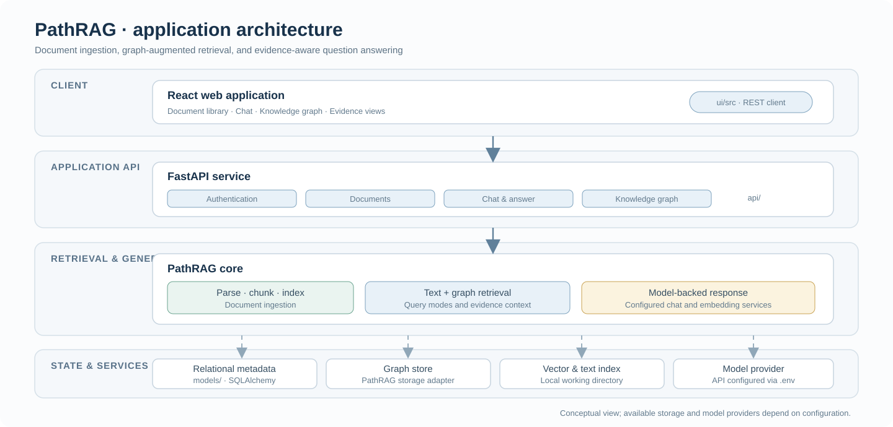

# PathRAG

**Evidence-aware retrieval-augmented question answering with a knowledge graph.**

PathRAG is a research prototype that combines document ingestion, graph-based retrieval, text/vector retrieval, and large-language-model response generation. The repository includes a FastAPI backend and a React web client for managing documents, asking questions, exploring the knowledge graph, and reviewing evidence traces.

> This is a research codebase. It is intended for local evaluation and development; it has not been hardened as a public multi-tenant service.

<p align="center">
  
</p>

## What it does

- **Ingests technical documents** and builds chunk-level, entity, relation, and embedding representations.
- **Retrieves across text and graph structure** to support queries that depend on both passages and entity relationships.
- **Generates answers from retrieved context** through a configurable model service.
- **Exposes a web application** for document upload, chat, graph browsing, and evidence inspection.
- **Keeps application metadata and retrieval indexes separate** so each can be configured and managed independently.

The exact retrieval behavior depends on the selected PathRAG query mode, storage backend, model provider, and configuration. The project does not claim that any answer is guaranteed to be complete or correct.

## Quick start

### Requirements

- Python 3.10 or later
- Node.js 18 or later and npm
- A compatible chat-completion and embedding API, or a locally hosted compatible service

### 1. Configure the backend

Create and activate a virtual environment, then install the Python dependencies:

```bash
python -m venv .venv
# macOS/Linux
source .venv/bin/activate
# Windows PowerShell
& .venv/Scripts/Activate.ps1

python -m pip install --upgrade pip
pip install -r requirements.txt
```

Copy `sample.env` to `.env` (`Copy-Item sample.env .env` in PowerShell, or `cp sample.env .env` on macOS/Linux). Set a unique `SECRET_KEY` and the model/embedding API settings required by your provider. Keep `.env` private; it is excluded from Git.

Start the API from the repository root:

```bash
uvicorn main:app --host 127.0.0.1 --port 8000
```

The interactive API reference is available at [http://localhost:8000/docs](http://localhost:8000/docs).

### 2. Start the web client

In a second terminal:

```bash
cd ui
npm install
npm start
```

Open [http://localhost:3000](http://localhost:3000), create an account, upload a document, and start a conversation. The client uses `http://localhost:8000` by default; set `REACT_APP_API_URL` if the API is hosted elsewhere.

For platform-specific notes, see [Installation](INSTALLATION.md) and [Quick start](QUICKSTART.md).

## How the application is organized

| Area | Responsibility |
| --- | --- |
| `PathRAG/` | Core graph-augmented retrieval, generation, and storage interfaces |
| `api/` | FastAPI routes for authentication, documents, chat, and graph operations |
| `models/` | Relational database models and session setup |
| `ui/` | React application and API client |
| `experiments/` | Source scripts for research and evaluation workflows |
| `tests/` | Unit and integration checks for selected modules |
| `tools/` | Development and diagnostic utilities |

See [Architecture](docs/ARCHITECTURE.md) for the request path, storage boundaries, and module map.

## Data, configuration, and privacy

Uploaded files, indexes, logs, and the SQLite database are runtime data. Keep them out of commits. The sample configuration stores working data under local directories; change those paths as needed.

When a hosted model or embedding provider is configured, prompts and retrieved text may be sent to that provider. Do not process confidential documents unless your provider, data policy, and authorization allow it. Before any deployment beyond localhost, replace development secrets, restrict CORS origins, review account registration, and add suitable access controls and operational monitoring.

## Research and reproducibility

This repository provides application and source code. It does not include manuscripts, proposals, CVs, private documents, generated result tables, or evaluation datasets. Reproduction of a particular experiment requires the corresponding public data, model versions, prompts, and protocol to be specified separately.

For a paper, cite a fixed release or commit when one is available; the `main` branch can change over time.

## License

No reuse license has been declared yet. Please contact the repository owner before redistributing or adapting this code.

---

## 中文简介

PathRAG 是一个面向文档问答的图增强检索生成研究原型，将文档处理、文本与向量检索、知识图谱检索及大语言模型生成整合在一起，并通过 FastAPI 和 React 提供文档管理、问答、图谱浏览及证据查看功能。

项目当前适合本地研究与开发。运行前请在 `.env` 中配置模型服务和密钥；上传文件、索引与数据库保存在本地运行目录。使用托管模型时，问题和检索片段可能会发送至相应服务商，请先确认数据使用权限。

中文部署说明见 [安装指南](INSTALLATION.md)。软件结构见 [架构说明](docs/ARCHITECTURE.md)。
