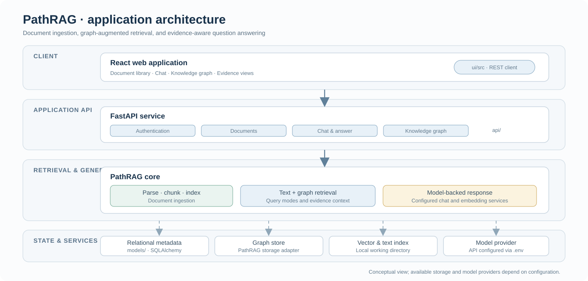

# Architecture

PathRAG is organized as a web application around a graph-augmented retrieval engine. This page describes the code boundaries and the data path; it does not imply that every optional feature is enabled in every configuration.

## Request path

### Document ingestion

1. The React client uploads a document through the document API.
2. The API extracts and prepares document text and tracks document metadata.
3. The PathRAG core splits content into chunks and derives entity/relation information.
4. Text embeddings and graph/index data are written to the configured working directory and storage backends.
5. The client can inspect document status and browse available graph information.

### Question answering

1. The client sends a question to the chat API.
2. The chat layer obtains a configured PathRAG instance from `api/features/rag_manager.py`.
3. The retrieval layer gathers text and graph context according to the selected query mode.
4. The configured language model produces a response using the retrieved context.
5. The API returns the response and any trace information exposed by the selected route.

### State boundaries

- `models/` stores relational application metadata such as accounts and document records.
- `PathRAG/` owns retrieval indexes and graph/vector storage adapters.
- `UPLOAD_DIR` holds uploaded source files.
- The model and embedding services are configured outside the code through environment variables.

These stores have different lifecycles. Back up the database, uploaded documents, and PathRAG working directory separately.

## Module map

| Path | Role |
| --- | --- |
| `PathRAG/` | Graph/text retrieval, language-model and embedding interfaces, storage abstractions |
| `api/auth/` | Registration, token issuance, and authentication dependencies |
| `api/features/documents/` | Document upload and document-related operations |
| `api/features/chats/` | Chat endpoints and answer orchestration |
| `api/features/knowledge_graph/` | Knowledge-graph API operations |
| `api/features/rag_manager.py` | Configuration and lifecycle of the shared PathRAG instance |
| `models/database.py` | SQLAlchemy models and database session setup |
| `ui/src/` | React pages, components, and backend API client |
| `experiments/` | Research and evaluation source scripts |
| `tests/` | Selected automated checks |

## Configuration flow

The API reads local environment variables from `.env` when present. The checked-in `sample.env` contains placeholders. Model credentials should remain local and should never be placed in source files, screenshots, issues, or logs.

For setup instructions, see [Installation](../INSTALLATION.md).
