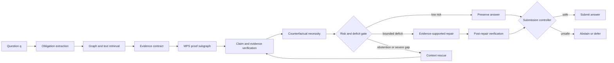
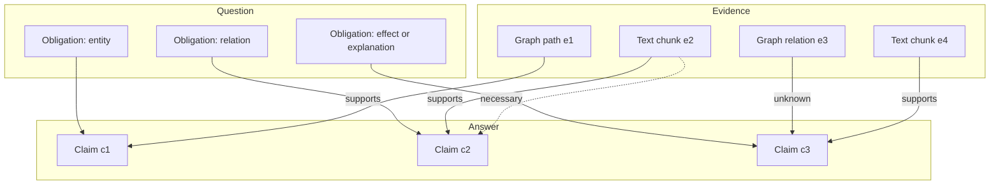
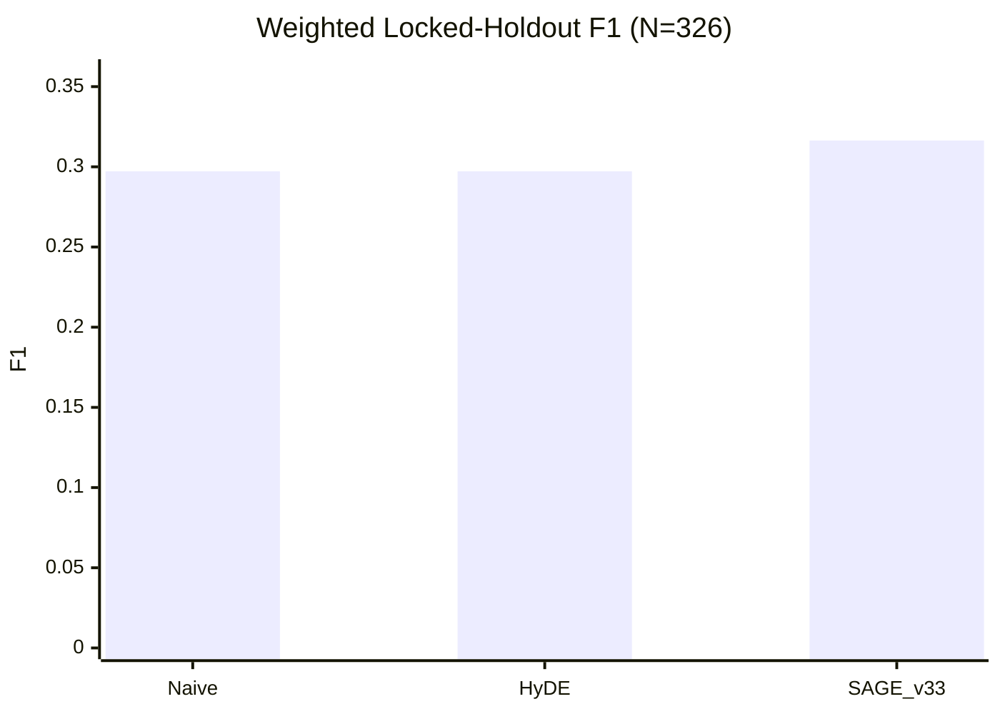
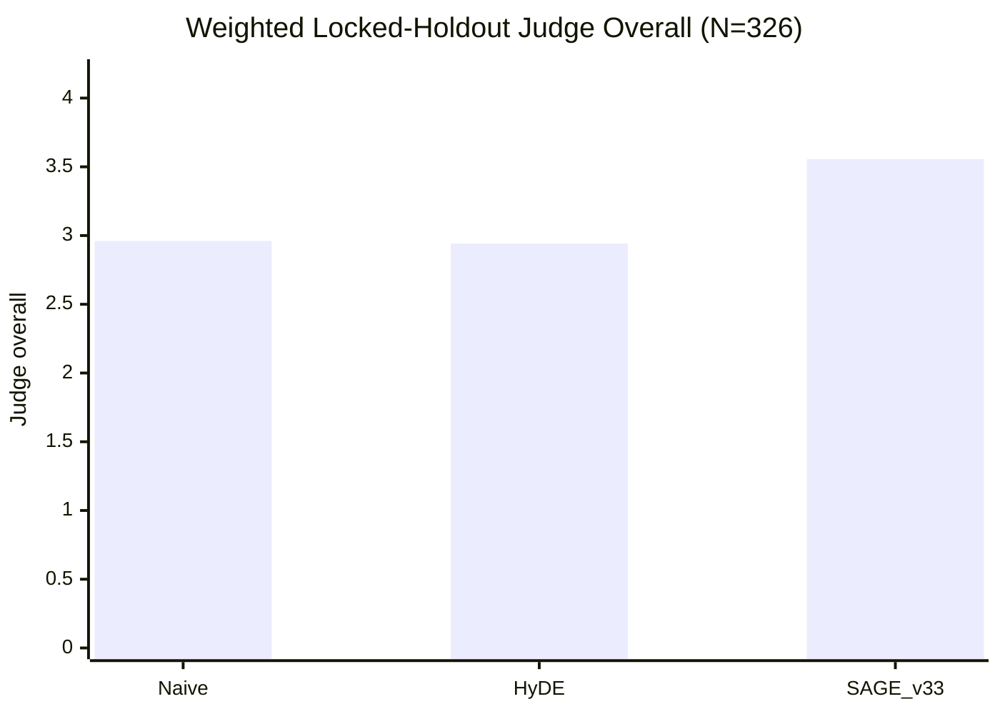
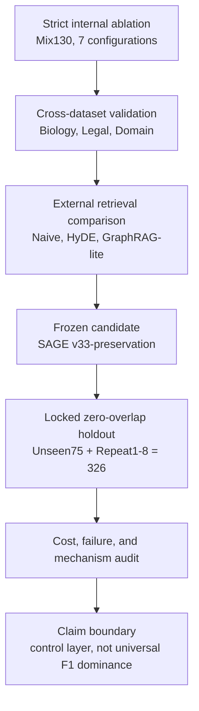
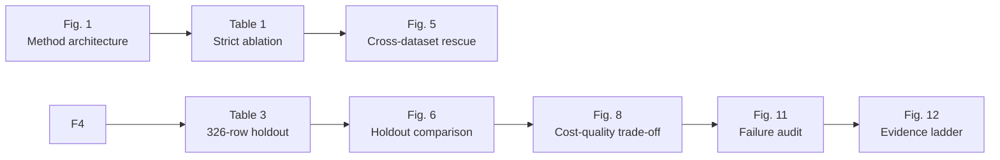

# VSR-PathRAG Paper Figures (Editable Markdown Source)

> This file contains the editable figure source for `PATHRAG_PAPER_DRAFT_ZH.md`. Mermaid diagrams can be previewed directly in editors that support Mermaid. The numeric data tables below each figure are the authoritative values used to redraw the figures later.

<style>
.three-line-table { width: 100%; border-collapse: collapse; border-top: 2px solid #444; border-bottom: 2px solid #444; margin: 0.8em 0 1.2em; }
.three-line-table th, .three-line-table td { border: 0; padding: 0.35em 0.55em; text-align: left; }
.three-line-table thead tr { border-bottom: 1px solid #444; }
</style>

## Figure 1. Method architecture

**Preview image:** `figures/vsr_pathrag_framework.png` (editable vector: `figures/vsr_pathrag_framework.svg`)



**Caption draft:** VSR-PathRAG turns question obligations, generated claims, and retrieved graph-text evidence into an evidence contract. Verification and counterfactual necessity produce risk signals. The controller preserves, repairs, rescues, or abstains depending on the contract deficit and safety envelope.

## Figure 2. Evidence contract representation

**Preview image:** `figures/evidence_contract.png` (editable vector: `figures/evidence_contract.svg`)



**Caption draft:** The contract links required question obligations to answer claims and signed evidence relations. A claim can be preserved only when its support is sufficient and contradictions are absent; necessity is estimated by counterfactual evidence removal.

## Figure 3. MPS selection and CPN necessity audit

**Preview image:** `figures/mps_cpn_mechanism.png` (editable vector: `figures/mps_cpn_mechanism.svg`)

```text
MPS: candidate evidence -> budgeted coverage score -> compact proof subgraph
CPN: remove selected evidence -> reselect/re-evaluate contract -> protect necessary evidence or mark redundancy
```

**Caption draft:** MPS selects a compact evidence subset under obligation, claim, and budget constraints. CPN removes each selected unit and re-evaluates the contract to distinguish indispensable evidence from redundancy. The two stages make evidence selection auditable without treating a larger context as an automatic improvement.

## Figure 4. Strict Mix130 ablation

**Preview image:** `figures/mix130_ablation.png` (editable vector: `figures/mix130_ablation.svg`)

```mermaid
xychart-beta
    title "UltraDomain Mix130 F1"
    x-axis [w/o_all, w/o_extract, w/o_verify, w/o_repair, full, full_v2, rescue]
    y-axis "F1" 0 --> 0.32
    bar [0.2276, 0.2285, 0.2138, 0.2206, 0.2437, 0.2824, 0.2878]
```

```mermaid
xychart-beta
    title "UltraDomain Mix130 Faithfulness"
    x-axis [w/o_all, w/o_extract, w/o_verify, w/o_repair, full, full_v2, rescue]
    y-axis "Faithfulness" 0 --> 1.0
    bar [0.5000, 0.5353, 0.5000, 0.8516, 0.8516, 0.9728, 0.9756]
```

**Caption draft:** The VSR v2 and rescue configurations provide the strongest combination of lexical quality and faithfulness. Rescue adds a small aggregate F1 increment over full_v2 on Mix130, while reducing abstention to 0.8%.

**Data:**

<table class="three-line-table">
<thead><tr><th>Configuration</th><th>F1</th><th>Faithfulness</th><th>Abstain</th></tr></thead>
<tbody>
<tr><td>w/o_all</td><td>0.2276</td><td>0.5000</td><td>21.5%</td></tr>
<tr><td>w/o_evidence_extraction</td><td>0.2285</td><td>0.5353</td><td>40.0%</td></tr>
<tr><td>w/o_verification</td><td>0.2138</td><td>0.5000</td><td>18.5%</td></tr>
<tr><td>w/o_repair</td><td>0.2206</td><td>0.8516</td><td>23.1%</td></tr>
<tr><td>full</td><td>0.2437</td><td>0.8516</td><td>27.7%</td></tr>
<tr><td>full_v2</td><td>0.2824</td><td>0.9728</td><td>8.5%</td></tr>
<tr><td>full_v2_rescue</td><td>0.2878</td><td>0.9756</td><td>0.8%</td></tr>
</tbody>
</table>

## Figure 5. Cross-dataset rescue validation

**Preview image:** `figures/cross_dataset_rescue.png` (editable vector: `figures/cross_dataset_rescue.svg`)

```mermaid
xychart-beta
    title "F1 Across Aligned Validation Slices"
    x-axis [UltraDomain, Biology, Legal, Domain]
    y-axis "F1" 0 --> 0.40
    bar [0.2206, 0.1557, 0.1791, 0.1629]
    bar [0.2878, 0.2287, 0.3496, 0.2337]
```



**Legend:** first bar = `w/o_repair`; second bar = `full_v2_rescue`. If the renderer does not show a legend, use the data table below when redrawing.

<table class="three-line-table">
<thead><tr><th>Dataset</th><th>w/o repair</th><th>full_v2_rescue</th><th>Delta</th></tr></thead>
<tbody>
<tr><td>UltraDomain mix</td><td>0.2206</td><td>0.2878</td><td>+0.0671</td></tr>
<tr><td>Biology full context</td><td>0.1557</td><td>0.2287</td><td>+0.0729</td></tr>
<tr><td>Legal full context</td><td>0.1791</td><td>0.3496</td><td>+0.1705</td></tr>
<tr><td>Domain expansion windowed</td><td>0.1629</td><td>0.2337</td><td>+0.0708</td></tr>
</tbody>
</table>

**Caption draft:** The rescue mechanism improves F1 over the aligned no-repair configuration on all four validation slices. Legal is the strongest but smallest slice and should be interpreted as supporting evidence rather than the sole headline result.

## Figure 6. Locked-holdout comparison

**Preview image:** `figures/locked_holdout_comparison.png` (editable vector: `figures/locked_holdout_comparison.svg`)





<table class="three-line-table">
<thead><tr><th>Method</th><th>F1</th><th>Judge overall</th><th>Pairwise target win rate</th></tr></thead>
<tbody>
<tr><td>Naive RAG</td><td>0.2972</td><td>2.960</td><td>baseline</td></tr>
<tr><td>HyDE</td><td>0.2972</td><td>2.942</td><td>baseline</td></tr>
<tr><td>SAGE v33-preservation</td><td>0.3164</td><td>3.555</td><td>59.66% vs HyDE; 61.50% vs Naive</td></tr>
</tbody>
</table>

**Caption draft:** The frozen SAGE v33-preservation policy improves both lexical and semantic metrics on the complete 326-row locked holdout, while the repeat-level results retain stress cases where the gain disappears or becomes negative.

## Figure 7. Locked-holdout stability by slice

**Preview image:** `figures/locked_holdout_stability.png` (editable vector: `figures/locked_holdout_stability.svg`)

The values below are F1 differences for SAGE v33-preservation minus each baseline on the frozen 326-row holdout slices. They are descriptive sub-slice diagnostics and were not used for version selection.

<table class="three-line-table">
<thead><tr><th>Slice</th><th>SAGE - Naive</th><th>SAGE - HyDE</th></tr></thead>
<tbody>
<tr><td>Unseen75</td><td>+0.0193</td><td>+0.0133</td></tr>
<tr><td>Repeat1</td><td>+0.0208</td><td>+0.0254</td></tr>
<tr><td>Repeat2</td><td>+0.0346</td><td>+0.0374</td></tr>
<tr><td>Repeat3</td><td>+0.0563</td><td>+0.0499</td></tr>
<tr><td>Repeat4</td><td>-0.0127</td><td>+0.0000</td></tr>
<tr><td>Repeat5</td><td>+0.0205</td><td>+0.0256</td></tr>
<tr><td>Repeat6</td><td>+0.0115</td><td>-0.0080</td></tr>
<tr><td>Repeat7</td><td>+0.0378</td><td>+0.0231</td></tr>
<tr><td>Repeat8</td><td>-0.0097</td><td>+0.0000</td></tr>
</tbody>
</table>

**Caption draft:** SAGE v33 has positive aggregate differences, but the repeat slices are heterogeneous. Repeat4 and Repeat8 are negative against Naive, while Repeat6 is negative against HyDE; this is why the locked aggregate is reported together with slice-level stability.

## Figure 8. Quality-cost trade-off

**Preview image:** `figures/quality_cost_tradeoff.png` (editable vector: `figures/quality_cost_tradeoff.svg`)

The three plotted points are the arithmetic means across the Legal, Biology and Domain-expansion aligned slices. SAGE v33 is reported as a locked-reference F1 annotation because its runtime was not measured under the same three-slice protocol.

<table class="three-line-table">
<thead><tr><th>Method</th><th>Mean runtime (s/q)</th><th>Mean F1</th><th>Source slices</th></tr></thead>
<tbody>
<tr><td>Naive RAG</td><td>6.13</td><td>0.2903</td><td>Legal, Biology, Domain</td></tr>
<tr><td>HyDE</td><td>16.60</td><td>0.2898</td><td>Legal, Biology, Domain</td></tr>
<tr><td>VSR rescue</td><td>49.93</td><td>0.2707</td><td>Legal, Biology, Domain</td></tr>
<tr><td>SAGE v33</td><td>not paired</td><td>0.3164</td><td>Locked 326-row reference; F1 only</td></tr>
</tbody>
</table>

<table class="three-line-table">
<thead><tr><th>Dataset</th><th>Naive s/q</th><th>HyDE s/q</th><th>VSR rescue s/q</th><th>Naive F1</th><th>HyDE F1</th><th>VSR rescue F1</th><th>SAGE v33 F1</th></tr></thead>
<tbody>
<tr><td>Legal</td><td>6.0</td><td>14.4</td><td>59.6</td><td>0.3632</td><td>0.3760</td><td>0.3496</td><td>0.3925</td></tr>
<tr><td>Biology</td><td>6.8</td><td>20.7</td><td>46.9</td><td>0.2365</td><td>0.2385</td><td>0.2287</td><td>0.2385</td></tr>
<tr><td>Domain</td><td>5.6</td><td>14.7</td><td>43.3</td><td>0.2711</td><td>0.2549</td><td>0.2337</td><td>0.2881</td></tr>
</tbody>
</table>

**Caption draft:** VSR rescue is materially more expensive than retrieval-only baselines and has the lowest mean F1 among the three latency-matched methods. SAGE v33 has a higher locked-reference F1, but its runtime was not paired with these external slices; the annotation therefore does not establish a complete quality-cost ranking.

## Figure 9. Token consumption by execution stage

**Preview image:** `figures/token_stage_breakdown.png` (editable vector: `figures/token_stage_breakdown.svg`)

The following values are mean Token counts per execution of a stage in the instrumented samples. They are not per-question totals.

<table class="three-line-table">
<thead><tr><th>Stage</th><th>Mean tokens</th><th>Observations</th></tr></thead>
<tbody>
<tr><td>evidence extraction</td><td>2,479</td><td>20</td></tr>
<tr><td>answer generation</td><td>1,915</td><td>20</td></tr>
<tr><td>verification</td><td>1,929</td><td>20</td></tr>
<tr><td>repair v2</td><td>865</td><td>10</td></tr>
<tr><td>post-repair verification</td><td>1,092</td><td>10</td></tr>
<tr><td>rescue evidence extraction</td><td>10,602</td><td>7</td></tr>
<tr><td>rescue answer generation</td><td>2,358</td><td>7</td></tr>
<tr><td>rescue verification</td><td>1,019</td><td>7</td></tr>
<tr><td>rescue repair</td><td>867</td><td>1</td></tr>
<tr><td>rescue post-verification</td><td>913</td><td>7</td></tr>
</tbody>
</table>

**Caption draft:** Rescue evidence extraction is the dominant per-stage Token cost in the instrumented sample. Because stages have different observation counts and can occur multiple times per question, the chart should not be summed as a replacement for the reported 12,558-token per-question mean.

## Figure 10. Mix130 quality-cost-faithfulness 3D

**Preview image:** `figures/mix130_quality_cost_faithfulness_3d.png` (editable vector: `figures/mix130_quality_cost_faithfulness_3d.svg`)

The three axes are F1, runtime in seconds per query, and faithfulness. The seven points use the strict Mix130 ablation values in Table 1. The connecting line is a visual trace of configuration progression and is not a fitted response surface.

**Caption draft:** The three-dimensional view makes the joint trade-off explicit: `full_v2` and `full_v2_rescue` occupy the high-faithfulness region, while `w/o_all` is cheaper but has lower F1 and faithfulness. Rescue adds a small quality change at nearly the same runtime as `full_v2` in this slice.

## Figure 11. Failure-mode audit of rescue decisions

**Preview image:** `figures/failure_mode_audit.png` (editable vector: `figures/failure_mode_audit.svg`)

```text
Audit source: CROSS_DATASET_QUALITY_FLAG_LLM_AUDIT.md, 15 rows
evidence_gap: 5
rescue_gate_overreach: 4
answer_hallucination: 4
overconservative_abstention: 1
reasonable_abstention: 1
```

**Caption draft:** The 15-row audit is multi-label: one row may contribute to more than one category. Evidence gaps and rescue-gate overreach are the most frequent tags, motivating acceptance gating and broader evidence retrieval before additional context expansion.

## Figure 12. Experimental evidence ladder

**Preview image:** `figures/evidence_ladder.png` (editable vector: `figures/evidence_ladder.svg`)



**Caption draft:** The paper's evidence ladder moves from mechanism isolation to generalization, comparison, frozen evaluation, and cost/failure analysis. The final claim is intentionally narrower than a universal baseline-superiority claim.

## Layout planning diagram (not a manuscript figure)



**Layout note:** Figures 1-3 should appear in the method section. Figures 4-10 belong in the main results section, Figure 11 belongs with the failure analysis, and Figure 12 is suitable for the discussion or conclusion. This planning diagram should not be included in the submitted manuscript.
