# 证据契约驱动的图 RAG 验证与选择性干预

> **稿件状态：** 中文主稿（持续修订）  
> **证据截止：** 以仓库中当前已经完成的本地实验为准  
> **主要数据来源：** [`results/paper_tables/PAPER_READY_EXPERIMENT_TABLES.md`](../results/paper_tables/PAPER_READY_EXPERIMENT_TABLES.md)  
> **可编辑图稿：** [`PAPER_FIGURES.md`](PAPER_FIGURES.md)

## 摘要

**研究目的：** 检索增强生成（Retrieval-Augmented Generation，RAG）能够利用外部知识缓解大语言模型的知识缺口，但检索相关性并不等价于问题义务的完整覆盖或答案陈述的证据充分性。本文旨在构建一种面向图 RAG 的可审计验证与选择性干预框架，并评估其对答案质量、证据一致性和运行成本的影响。

**方法：** 提出 VSR-PathRAG 框架，将问题表示为回答义务，将生成答案分解为原子陈述，并建立陈述—义务—图文本证据之间的证据契约。框架采用最小证明子图（Minimal Proof Subgraph，MPS）进行预算约束下的证据选择，利用反事实路径必要性（Counterfactual Path Necessity，CPN）识别不可替代证据，并通过风险门控控制器在保留（preserve）、有界修复（repair）、上下文救援（rescue）和拒答（abstain）之间进行选择。实验包括 UltraDomain Mix130 的严格七配置消融、Biology/Legal/Domain-expansion 对齐验证，以及 326 条来源不重叠锁定留出样本上的冻结候选比较。

**结果：** 在 Mix130 消融实验中，`full_v2_rescue` 相对于无修复配置将 F1 从 0.2206 提升至 0.2878（+0.0671，配对检验 p=1.119×10⁻¹¹，Cohen's d=0.60），将 ROUGE-L 从 0.1591 提升至 0.2194（+0.0603）；忠实度达到 0.9756，拒答率从 23.1% 降至 0.8%。在 Biology、Legal 和 Domain-expansion 切片上，救援分支的 F1 分别从 0.1557 提升至 0.2287、从 0.1791 提升至 0.3496、从 0.1629 提升至 0.2337。冻结的 SAGE v33-preservation 在 326 条锁定留出样本上的 F1 为 0.3164，高于 Naive RAG 和 HyDE 的 0.2972；语义评审总体分为 3.555，相对于 HyDE 和 Naive RAG 的目标胜率分别为 59.66% 和 61.50%。

**结论：** 结果表明，证据契约、陈述级验证、受控修复和选择性救援可以作为图 RAG 的组合式控制层。然而，VSR rescue 的运行时间约为 Naive RAG 的 6.88—9.89 倍，且当前风险分数主要反映样本困难度，尚不能稳定预测干预收益。因此，VSR-PathRAG 更适合被定位为成本感知的证据控制框架，而不是在所有任务上替代或全面优于检索基线的方法。

**关键词：** 检索增强生成；图 RAG；证据验证；答案修复；风险校准；选择性检索；幻觉控制

<!-- 工作稿目录：定稿前保留导航；投稿版按 SCI/顶会模板可在最终导出时删除。
## 目录

- [1 引言](#1-引言)
  - [1.1 研究动机](#11-研究动机)
  - [1.2 研究问题](#12-研究问题)
  - [1.3 主要贡献](#13-主要贡献)
    - [1.3.1 核心贡献](#131-核心贡献)
    - [1.3.2 贡献边界与评价原则](#132-贡献边界与评价原则)
  - [1.4 论文结构](#14-论文结构)
- [2 相关工作与问题定义](#2-相关工作与问题定义)
  - [2.1 相关工作](#21-相关工作)
  - [2.2 证据覆盖](#22-证据覆盖)
  - [2.3 必要性与风险](#23-必要性与风险)
  - [2.4 研究定位与问题边界](#24-研究定位与问题边界)
- [3 VSR-PathRAG 方法](#3-vsr-pathrag-方法)
  - [3.1 方法架构与证据契约](#31-方法架构与证据契约)
  - [3.2 证据契约表示与验证](#32-证据契约表示与验证)
  - [3.3 证据选择与最小证明子图](#33-证据选择与最小证明子图)
  - [3.4 受控干预与选择性路由](#34-受控干预与选择性路由)
  - [3.5 运行时流程与审计记录](#35-运行时流程与审计记录)
- [4 实验方案](#4-实验方案)
  - [4.1 数据切面](#41-数据切面)
  - [4.2 对比系统](#42-对比系统)
  - [4.3 评价指标](#43-评价指标)
  - [4.4 统计协议](#44-统计协议)
  - [4.5 冻结与数据隔离规则](#45-冻结与数据隔离规则)
- [5 实验结果](#5-实验结果)
  - [5.1 Mix130 严格 VSR 消融](#51-mix130-严格-vsr-消融)
  - [5.2 跨数据集验证](#52-跨数据集验证)
  - [5.3 冻结 SAGE 候选与锁定留出集](#53-冻结-sage-候选与锁定留出集)
  - [5.4 检索与图 RAG 对比](#54-检索与图-rag-对比)
  - [5.5 运行时间与 Token 成本](#55-运行时间与-token-成本)
  - [5.6 失败模式与质量分析](#56-失败模式与质量分析)
  - [5.7 研究问题回答](#57-研究问题回答)
- [6 讨论](#6-讨论)
  - [6.1 机制结果的解释](#61-机制结果的解释)
  - [6.2 跨数据集泛化](#62-跨数据集泛化)
  - [6.3 与外部基线的关系](#63-与外部基线的关系)
  - [6.4 质量与成本权衡](#64-质量与成本权衡)
  - [6.5 主要结论的边界](#65-主要结论的边界)
- [7 局限性与未来工作](#7-局限性与未来工作)
  - [7.1 数据与实验范围](#71-数据与实验范围)
  - [7.2 评价与因果性限制](#72-评价与因果性限制)
  - [7.3 后续实验计划](#73-后续实验计划)
- [8 结论](#8-结论)
  - [8.1 主要发现](#81-主要发现)
  - [8.2 研究结论与适用范围](#82-研究结论与适用范围)
- [参考文献](#参考文献)
-->

## 1 引言

### 1.1 研究动机

RAG 系统通过让大语言模型条件化使用检索文档、图邻域或混合图文本上下文，缓解模型的知识缺口。然而，检索到的上下文即使具有相关性，也不一定充分。模型可能遗漏问题要求的某个方面，加入证据无法推出的陈述，或者在有界修复本可恢复受支持答案时过早拒答。对于多跳和领域特定问题，这些失败尤为重要，因为答案质量依赖多个证据单元之间的关系，而不只是单个高相似度段落。

图 RAG 提供了显式的关系结构，但图邻域本身并不是证明。现有流程通常缺少一个统一的运行时对象，用于记录问题义务是否被覆盖、答案陈述是否被支持、哪些证据路径是必要的，以及最终答案是否适合提交。本文研究这一缺失的控制层。

**RAG 的证据充分性问题。**

RAG 的核心流程通常包括查询编码、候选检索、上下文拼接和答案生成。这个流程默认一个隐含假设：只要检索结果与问题相关，生成器就能从中恢复完整且正确的答案。实际运行中，相关性与充分性并不等价。一个段落可能包含问题实体，却没有回答问题要求的关系；多个段落可能分别包含局部事实，却没有形成能够支撑最终结论的完整链路；生成器还可能把相邻但无关的事实拼接成新的陈述。

因此，答案评价至少包含三个层次：是否覆盖问题要求、是否得到证据支持、是否在不引入新风险的情况下完成表达。只使用答案—参考答案相似度，无法区分“说得像但缺少证据”和“表达不同但证据充分”这两类情况。本文将这三个层次显式化为义务、陈述和证据之间的契约关系。

**图结构带来的机会与风险。**

图结构可以帮助系统沿实体、关系和多跳路径组织证据，尤其适合需要解释关系或组合多个事实的问题。相较于只按段落相似度排序，图遍历能够提供实体邻域、关系方向和路径长度等额外信号。但图结构也会放大错误传播：一个错误实体链接、过宽的邻域或不受约束的路径扩展，都可能把大量看似相关但无法支持答案的节点带入上下文。

这意味着图 RAG 需要一个“路径是否足以证明”的判断，而不只是“路径是否存在”的判断。VSR-PathRAG 使用 MPS 选择满足义务覆盖的证据子集，再使用 CPN 检查哪些路径在移除后会导致契约失效，从而把图结构转化为可审计的证据结构。

**研究缺口。**

现有研究分别关注检索质量、图结构构建、生成事实性或自我反思，但这些模块之间缺少统一的中间表示。特别是以下三个问题仍缺少系统性回答：第一，如何把自然语言问题的多个回答要求映射为可检查的义务；第二，如何判断答案中的局部陈述是否由最小证据集合支持；第三，在答案不安全时，系统应选择修复、扩大上下文还是拒答。

本文不试图重新提出一个检索器或更大的生成模型，而是针对这三个缺口设计证据契约、反事实必要性和风险有界控制器，并用对齐消融和冻结留出实验分别验证内部机制与外部泛化。

### 1.2 研究问题

本文围绕以下四个问题组织实验：

1. **RQ1——机制：** 加入证据抽取、验证、修复和救援后，相对于对齐的 VSR 消融配置，答案质量和证据 grounding 是否提高？
2. **RQ2——泛化：** 内部机制增益能否在 Biology、Legal 和 Domain-expansion 验证切片上保持？
3. **RQ3——比较：** 冻结的证据感知路由策略在来源不重叠的锁定留出集上，能否与 Naive RAG 和 HyDE 保持竞争力？
4. **RQ4——成本与失败：** 验证和上下文救援带来了怎样的运行时间、Token 消耗和失败模式权衡？

**机制问题。**

RQ1 关注 VSR 组件是否具有可分离的作用。实验不仅比较完整系统与最弱基线，还逐一移除证据抽取、验证和修复阶段，观察 F1、ROUGE-L、忠实度、拒答率和运行时间的变化。这样可以避免把多个同时变化的工程因素错误归因于单一模块。

**泛化与比较问题。**

RQ2 和 RQ3 分别处理两类泛化：第一类是在不同领域或上下文切片上重复内部机制，第二类是在方法冻结后与外部检索基线比较。两类实验使用不同证据表面，不能用一个总平均替代，因此本文在结果部分分开报告。

**成本与安全问题。**

RQ4 关注质量提升是否值得额外成本，以及风险分数是否能够帮助系统选择应升级的问题。该问题尤其重要，因为完整验证和救援流程的调用次数明显高于普通 RAG。如果系统无法选择性地分配预算，那么离线分数提升可能无法转化为实际部署收益。

四个研究问题对应三条可检验的研究假设。其一，若证据抽取和陈述级验证真正形成了中间控制层，则移除验证或修复应导致 F1、忠实度或拒答行为出现可解释的退化，而不只是改变最终输出长度。其二，若救援机制恢复的是证据缺口而非特定领域的词汇模式，则在 Biology、Legal 和 Domain-expansion 切片上应保持同方向增益，同时允许增益幅度和安全性随证据密度变化。其三，若冻结路由具有部署价值，则其优势应在来源不重叠留出集上同时反映在词法质量、语义评审或成对偏好中的至少两类指标，并且不依赖留出结果继续调参。本文在第 5 节分别用严格消融、跨切片验证和锁定元汇总检验这三条假设。

### 1.3 主要贡献

#### 1.3.1 核心贡献

本文的主要贡献包括：

1. **证据契约：** 统一表示问题义务、答案陈述、证据支持关系和提交风险。
2. **验证与受控干预：** 通过最小证明子图和反事实证据移除识别支持信号与必要性信号。
3. **风险有界的修复与救援：** 在证据允许时执行有界修复，在触发拒答时升级到更大上下文，并阻止超出安全边界的改写。
4. **完整实验材料：** 提供严格七配置消融、跨数据集验证、图 RAG 补充比较、冻结的 SAGE v33 候选和 326 条完整零重叠留出样本。

#### 1.3.2 贡献边界与评价原则

**结论边界。** 本文有意限定主要结论的适用范围：`full_v2_rescue` 被视为 VSR 内部机制结果，`SAGE v33-preservation` 被视为冻结后的比较候选；v56 等探索性分支不作为论文主结果。

**设计原则。** 本文遵循三个设计原则。第一，将检索与验证分工：检索阶段尽可能发现候选证据，验证阶段判断候选证据是否足以支撑具体义务和陈述，避免把召回率直接当作答案可信度。第二，将上下文预算用于增加可证明性，而不是无条件增加长度；证据选择应优先覆盖未满足义务和高风险陈述，并在达到契约要求后停止扩张。第三，将干预设计为可回退操作：每次修复或救援都必须经过再次验证，若新增内容不能提升契约状态或引入矛盾，则保留原答案或拒答。

**评价准则。** 上述原则也决定了本文的比较单位。本文不把“多生成一次”或“多检索一轮”本身视为方法贡献，而是比较干预前后契约状态、答案质量和资源消耗的联合变化。对于同一问题，若修复提高 F1 但降低忠实度，或者救援降低拒答率但引入未经支持的陈述，则该动作不能被视为无条件成功。只有当动作在预先定义的安全边界内改善至少一个目标、且没有显著恶化其他核心指标时，才作为机制证据报告。

**审计维度。** 与只报告一个最终分数的系统不同，本文同时记录答案质量、证据状态、决策状态和成本。这样的记录方式使论文能够区分“检索没有找到证据”“找到了证据但答案没有使用”“答案使用了未经支持的内容”和“系统正确地选择了拒答”等不同情况，也为后续部署中的审计和错误分析提供依据。

### 1.4 论文结构

第 2 节回顾相关工作并定义证据契约问题；第 3 节介绍 VSR-PathRAG 流程；第 4 节说明实验方案；第 5 节报告结果；第 6 节讨论机制、成本和结论边界；第 7 节说明局限性与未来工作；第 8 节总结全文。

## 2 相关工作与问题定义

### 2.1 相关工作

近年来的 RAG 研究可以按“证据发现—答案生成—事实性评估—选择性控制”四个层次组织。本文不把这些方向简单合并为一个更大的检索器，而是借鉴其问题分解方式，明确证据契约在生成流程中的接口位置。

**图结构检索与多跳证据组织。**

图 RAG 工作利用实体、关系、社区和路径结构扩大候选证据的覆盖范围。[From Local to Global](https://arxiv.org/abs/2404.16130) 通过社区级摘要处理局部事实与全局问题之间的尺度差异；[G-Retriever](https://doi.org/10.52202/079017-4224) 将文本图理解与检索增强生成结合；[LightRAG](https://aclanthology.org/2025.findings-emnlp.568/) 则强调轻量级图索引和双层检索（对应文献 [7,10,11]）。它们主要回答“哪些节点或路径应进入上下文”，但路径存在并不等价于路径已经完成问题义务，也不等价于生成陈述得到充分支持。本文沿用图路径作为候选证据来源，同时增加义务覆盖、陈述支持和路径必要性三个运行时状态。

**自反思、纠错与引用归因。**

[Self-RAG](https://openreview.net/forum?id=hSyW5go0v8) 通过反思标记决定何时检索、何时批判和何时继续生成，[Corrective RAG](https://arxiv.org/abs/2401.15884) 根据检索质量触发纠错或替代检索，[ALCE](https://aclanthology.org/2023.emnlp-main.398/) 进一步关注答案与引用证据之间的可追溯关系（对应文献 [1,2,12]）。这些工作说明“生成后再检查”是 RAG 控制的重要组成部分，但自反思信号通常仍以整体答案或检索质量为单位。本文把控制粒度推进到原子陈述和问题义务，并把修复动作限制在可定位证据支持的编辑范围内。

**事实性评估与陈述级诊断。**

[ARES](https://aclanthology.org/2024.naacl-long.20/)、[RAGTruth](https://aclanthology.org/2024.acl-long.585/)、[RAGChecker](https://doi.org/10.52202/079017-0692) 和 [Synchronous Faithfulness Monitoring](https://aclanthology.org/2024.emnlp-main.527/) 分别从自动评价、幻觉语料、细粒度诊断和同步监测角度刻画 RAG 的事实性风险（对应文献 [3–6,9]）。这些方法为忠实度、归因和错误分类提供了评价依据，但主要回答“系统当前有多可信”，不直接规定“发现风险后应保留、修复、扩大上下文还是拒答”。本文将事实性判断作为契约状态输入，再由风险控制器选择干预动作。

**选择性预测与成本感知控制。**

选择性预测研究通常在质量、覆盖率和拒答风险之间进行权衡。对 RAG 而言，选择性控制还需要把额外检索、验证和生成的成本纳入决策：高风险样本值得升级并不意味着所有困难样本都值得升级。本文因此将风险分数视为困难度信号而非已校准的收益概率，并在实验中同时报告升级后的质量、拒答行为、延迟和 Token 消耗。

综上，现有工作分别改善了证据发现、答案自检、事实性评估和引用追踪，但通常将“检索到什么”“答案说了什么”和“哪些证据是必要的”分散在不同模块中。对于需要多跳关系和高风险输出的任务，系统仍需要一个统一的中间对象来记录问题义务、原子陈述、证据关系和干预依据。本文的证据契约正是针对这一接口缺口提出的控制表示。

**相关工作对照表（背景表，不计入实验表号）。**

<table class="three-line-table">
<thead><tr><th>研究方向</th><th>代表工作</th><th>主要解决的问题</th><th>与本文的差异</th></tr></thead>
<tbody>
<tr><td>图结构 RAG</td><td>From Local to Global；G-Retriever；LightRAG</td><td>图检索、子图组织和多跳推理</td><td>通常不统一记录义务覆盖、陈述支持和必要路径</td></tr>
<tr><td>自反思与纠错</td><td>Self-RAG；Corrective RAG</td><td>决定是否检索、反思或修正答案</td><td>较少显式建模证据契约和干预后的安全边界</td></tr>
<tr><td>事实性与 RAG 评价</td><td>ARES；RAGTruth；RAGChecker；Synchronous Faithfulness Monitoring</td><td>度量相关性、忠实度、幻觉和诊断信号</td><td>主要提供评价或监测，不直接定义 preserve/repair/rescue/abstain 路由</td></tr>
<tr><td>引用与证据归因</td><td>ALCE</td><td>生成可追溯引用和支持证据</td><td>不重点处理图路径必要性、选择性救援和成本门控</td></tr>
<tr><td>本文方法</td><td>VSR-PathRAG</td><td>统一义务、陈述、证据和提交风险</td><td>通过 MPS、CPN 和风险控制器连接验证、修复、救援与拒答</td></tr>
</tbody>
</table>

上述工作构成本文的比较基线和理论背景，而不是被简单合并为一个“最佳方法”。本文关注的问题更具体：在图文本证据已经被检索后，系统能否判断证据是否足以完成问题义务，识别哪些证据路径不可替代，并以可控成本选择保留、修复、救援或拒答。

设 $q$ 为问题，$G=(V,E)$ 为图文本知识库，$D(q)$ 为检索证据，$a$ 为生成答案。我们抽取：

- 义务 $O(q)=\{o_1,\ldots,o_P\}$，表示问题要求覆盖的方面；
- 陈述 $C(a)=\{c_1,\ldots,c_M\}$，表示草稿答案中的原子命题；
- 证据单元 $E(q)=\{e_1,\ldots,e_N\}$，表示图关系、实体和文本片段。

为便于后续定义，本文使用下方符号表所示的约定。图中的实体、关系和文本片段可以来自同一知识库的不同表示层；证据契约并不要求所有证据具有相同的粒度，而要求每个证据都能够被定位、比较和重新验证。

<table class="three-line-table">
<thead><tr><th>符号</th><th>定义</th><th>在控制流程中的作用</th></tr></thead>
<tbody>
<tr><td><code>q</code></td><td>用户问题</td><td>生成回答义务并触发检索</td></tr>
<tr><td><code>G=(V,E)</code></td><td>图文本知识库</td><td>提供实体、关系、路径和文本证据</td></tr>
<tr><td><code>O(q)</code></td><td>问题义务集合</td><td>定义答案必须覆盖的方面</td></tr>
<tr><td><code>C(a)</code></td><td>答案陈述集合</td><td>定义需要逐条验证的命题</td></tr>
<tr><td><code>E(q)</code></td><td>候选证据集合</td><td>作为 MPS 选择和 CPN 干预的输入</td></tr>
<tr><td><code>S</code></td><td>选定证明子集</td><td>作为最终答案的可审计证据上下文</td></tr>
</tbody>
</table>

**符号表。** VSR-PathRAG 的核心对象及其在控制流程中的作用。

证据契约是一个带符号的关系结构 $\Phi(e_j,c_i)\in\{+1,0,-1\}$，分别表示支持、未知和矛盾，同时包含义务覆盖率与风险信号。当选定证据覆盖了必需的问题义务，且每条提交的实质性陈述都有足够支持时，称草稿答案满足契约。

本文采用两个层次的契约判定。第一层是证据充分性：选定证据是否覆盖了问题要求的义务，并为答案中的陈述提供正向支持。第二层是提交安全性：即使存在支持证据，是否仍然存在矛盾、必要证据缺失、来源不可追溯或修复幅度过大的风险。只有同时通过这两个层次，答案才可以进入直接提交路径；否则控制器需要选择修复、救援或拒答。

在实际系统中，契约判定还受到三类不确定性的影响。义务抽取可能遗漏问题中的隐含条件，陈述分解可能把复合事实切分得过粗或过细，证据关系判断也可能受到语言模型评审误差影响。因此，本文将契约作为可审计的控制信号，而不是对事实真值的形式证明；主结果也同时报告词法、忠实度、语义评审和成本指标。

### 2.2 证据覆盖

对于选定证据子集 $S\subseteq E(q)$，定义：

$$
\operatorname{Cov}_O(S)=\frac{1}{P}\sum_{i=1}^{P}\mathbf{1}[o_i\ \text{被}\ S\ \text{覆盖}],
$$

$$
\operatorname{Cov}_C(S)=\frac{1}{M}\sum_{i=1}^{M}\mathbf{1}[\exists e_j\in S:\Phi(e_j,c_i)=+1].
$$

证据契约并不声称词法重叠就等价于事实为真，而是一个操作性结构，用于判断答案是否拥有足够的可审计支持，从而决定保留、修复或暂缓提交。

**问题义务。**

问题义务是对问题中必须回答的内容进行结构化拆分。例如，一个问题可能同时要求识别实体、说明实体之间的关系、给出影响或原因，并限定时间、领域或条件。义务抽取不直接决定答案文本，而是定义后续检索和验证必须满足的覆盖目标。义务之间可以存在依赖关系：只有先确认实体，关系义务才有明确的主语和宾语；只有关系被确认，影响或解释义务才具有可验证对象。

**陈述覆盖。**

答案陈述是可以单独判断支持关系的最小命题单元。过于粗粒度的整句会把多个事实混在一起，使一条部分支持的句子被误判为完全支持；过于细粒度则会增加验证成本并导致自然语言表达被过度切碎。因此实现采用面向原子事实的实用拆分，并把不可独立验证的修饰语保留在其主陈述中。

义务覆盖与陈述覆盖并不相同。答案可以覆盖了问题要求的实体和关系，但加入一个没有证据支持的额外陈述；也可以每条陈述都被局部证据支持，却遗漏问题要求的一个方面。VSR 同时计算两类覆盖率，以避免只优化其中一项。

**覆盖的局限。**

覆盖率是一种操作性指标，不是事实性的充分条件。证据可能本身包含错误，支持关系可能依赖语义判定而非严格逻辑蕴含，问题义务抽取也可能遗漏隐含要求。因此，本文把覆盖作为提交控制的必要信号之一，并结合矛盾检测、必要性检查和语义评审，而不把覆盖分数直接解释为事实概率。

### 2.3 必要性与风险

如果移除某个证据单元后，重新优化仍会导致某项义务覆盖约束或陈述覆盖约束失败，则该证据单元被视为反事实必要证据。提交风险建模为不受支持陈述、矛盾信号、义务缺口和未经认证的证据依赖等因素的加权组合：

$$
R(a,S)=w_u r_u+w_k r_k+w_o r_o+w_n r_n+w_c r_c,
$$

其中各项分别表示不受支持陈述风险、矛盾风险、义务缺口风险、必要性缺口风险和审计风险。控制器把该分数作为决策信号，而不是事实为真的概率校准值。

**反事实必要性。**

反事实必要性回答的是“如果没有这条证据，当前答案还能否满足契约”。对于每个选定证据单元，CPN 暂时将其移除，再在相同预算下重新选择证据。如果某个问题义务从覆盖变为缺失，或者某条陈述从受支持变为未知，则该单元被标记为必要或高影响证据。与简单统计证据出现次数相比，这种方法可以识别被冗余证据掩盖的关键路径。

必要性检查也存在计算开销。它需要对若干证据单元重复运行选择过程，并且依赖当前的候选集合。本文将 CPN 用作干预特征和审计记录，而不是把它解释成完整知识图谱中的唯一证明。

**风险组成。**

风险项可以按来源分为五类：不受支持陈述风险衡量答案中缺少正向证据的命题；矛盾风险衡量证据与答案之间的冲突；义务缺口风险衡量问题要求未被覆盖的部分；必要性缺口风险衡量关键证据是否不可替代；审计风险则衡量证据来源、路径或判断过程是否缺少可追溯记录。

控制器根据这些信号和阈值选择动作。阈值的作用是定义安全边界，而不是提供跨数据集可直接比较的概率校准。后续的影响感知路由需要进一步学习“风险、额外成本和预期质量增益”的联合决策函数。

### 2.4 研究定位与问题边界

传统 RAG 通常把检索器输出的文档片段直接交给生成器，评价重点是答案与参考答案之间的词法或语义相似度。HyDE 通过先生成假设文档改善检索，图 RAG 则利用实体、关系和社区结构扩大候选证据。这些方法解决的是“从哪里找证据”或“如何构造上下文”的问题，但并不天然记录每个问题义务是否被覆盖，也不要求对答案中的每条原子陈述建立可审计支持关系。

VSR-PathRAG 的定位是检索与生成之间的控制层。它不要求用一个更大的生成模型替代检索器，而是在生成前后维护证据契约：生成前检查候选证据能否覆盖问题义务，生成后检查陈述是否被支持，发生缺口时只允许在安全边界内修复或扩大上下文。由此，本文的研究问题与单纯比较检索器排名不同，重点是验证和干预是否能改善最终可提交答案。

本文还把“拒答”视为一种合法的系统状态，而不是简单的失败样本。对于不能被当前证据安全支持的问题，拒答可以避免加入未经证实的陈述；对于仅存在局部缺口的问题，修复和救援则提供比直接拒答更细粒度的干预。因此，VSR 的评价同时关注 F1、忠实度、拒答率、救援收益和额外成本。

从相关研究的任务划分看，现有方法大致可以分为四类。第一类方法改进文本检索或假设文档检索，主要目标是提高候选证据召回；第二类方法使用知识图谱、社区结构或子图检索来表达实体关系和多跳路径；第三类方法通过自反思、事实核查或陈述级归因降低生成幻觉；第四类方法研究拒答、风险校准和选择性预测，以控制不确定输出。VSR-PathRAG 位于这四类方法的交叉位置，但并不试图替代它们：它把检索结果转化为可审计契约，并将核查信号用于修复、救援和提交决策。

这一定位也说明了本文与单纯扩大上下文的区别。更大的上下文可能提高证据召回，却同时增加冗余、冲突和 Token 成本，并可能使生成器难以定位关键证据。图结构可以提供路径和关系，但一条路径存在并不意味着它能够覆盖问题的所有义务。VSR 的重点是选择满足契约的证据子集，并在证据不足时明确触发干预，而不是将“更多上下文”作为默认答案。

## 3 VSR-PathRAG 方法

### 3.1 方法架构与证据契约

方法整体流程见图 1。图稿的可编辑版本和精确绘图数据统一保存在 [`PAPER_FIGURES.md`](PAPER_FIGURES.md)。

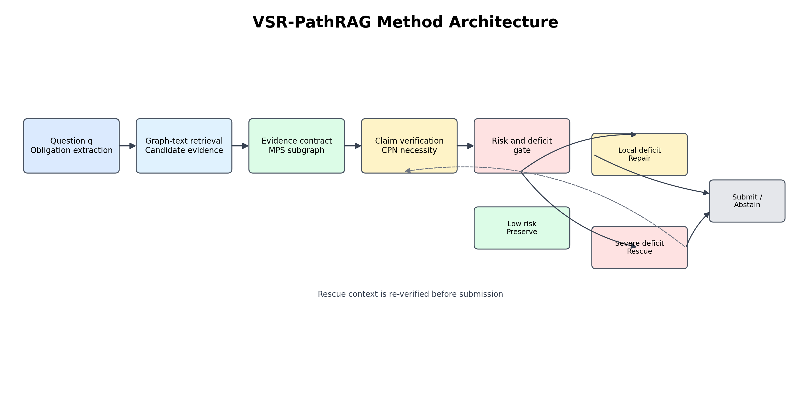

**图 1. VSR-PathRAG 方法整体架构。** 系统将问题义务、生成陈述和图文本证据组织为证据契约，并依据验证、反事实必要性和风险门控结果执行保留、修复、救援或拒答。

### 3.2 证据契约表示与验证

图 2 展示证据契约的基本关系。问题义务先约束答案需要覆盖的内容，证据再通过支持、未知或矛盾关系连接到具体陈述；必要性关系由移除证据后的契约退化情况确定。

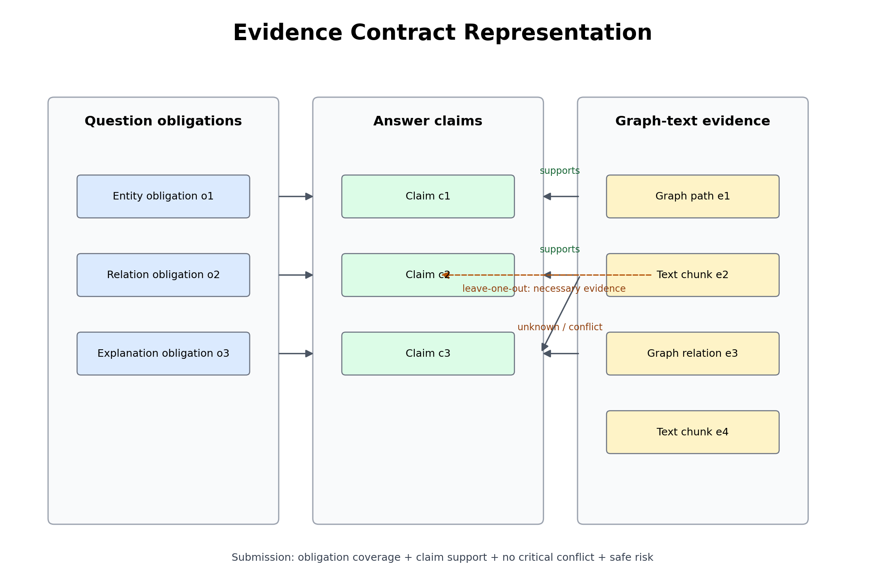

**图 2. 证据契约表示。** 只有在问题义务得到覆盖、陈述具有充分支持且不存在关键矛盾时，答案才可以进入保留或提交状态。

### 3.3 证据选择与最小证明子图

图 3 展示 MPS 与 CPN 的互补关系：MPS 在预算约束下选择紧凑的证明子图，CPN 再通过移除证据并重新评估，识别真正不可替代的证据单元。两者共同把“检索到相关内容”转化为“保留足以支持当前答案的证据”。

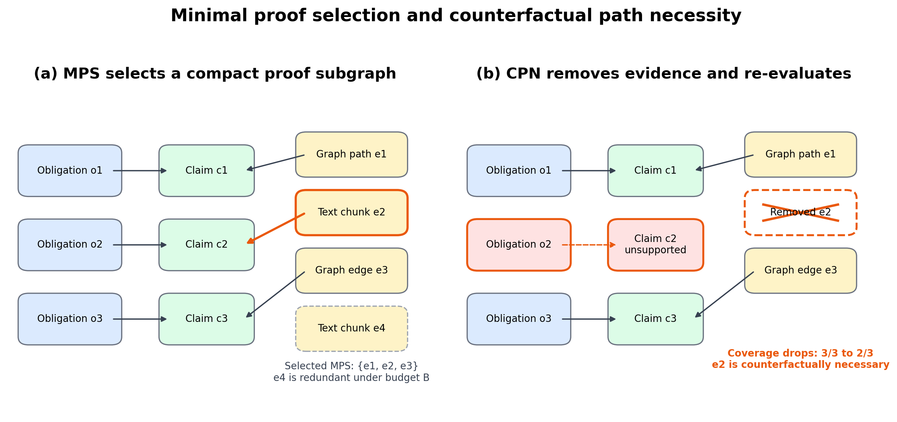

**图 3. MPS 选择与 CPN 必要性检验机制。** 左侧表示在义务覆盖、陈述支持和预算约束下选择紧凑证明子图；右侧表示移除候选证据后重新计算契约状态，并据此保护必要证据或删除冗余证据。该图说明 CPN 是验证后的反事实审计，而不是额外的自由生成步骤。

流程首先分析问题并创建义务集合，然后通过图遍历和文本检索生成候选证据。最小证明子图（Minimal Proof Subgraph，MPS）在 Token 或基数预算下选择能够共同覆盖问题义务和候选陈述的证据。随后进行留一审计，移除冗余证据并记录最小性证书。

证据选择目标为：

$$
\max_{S\subseteq E(q)}\ \alpha\operatorname{Cov}_O(S)+(1-\alpha)\operatorname{Cov}_C(S)
$$

约束为 $|S|\leq K$ 且 $\operatorname{tokens}(S)\leq B$。实现采用边际效用启发式，再执行冗余审计。本文把该优化作为系统机制进行评价，不把渐近近似直觉当作经验结果。

**契约数据结构。**

每个问题的证据契约至少包含五类字段：问题义务列表、答案陈述列表、证据单元列表、陈述—证据关系矩阵，以及决策和风险字段。义务记录其类型、文本描述和覆盖状态；陈述记录原答案、修复候选和最终状态；证据记录来源、图路径或文本位置、上下文哈希和必要性标记。关系矩阵允许同一证据支持多个陈述，也允许记录未知或矛盾关系。

这种结构使中间结果从提示词中的隐含判断变成可以保存和比较的对象。实验日志可以据此回答某个答案为什么被修复、某条证据为什么被保留，以及某个拒答是由义务缺口还是矛盾信号触发。它也为后续人工抽查提供了明确入口。

**最小证明子图目标。**

MPS 的目标是在有限预算下最大化义务覆盖和陈述覆盖。实际选择采用边际效用排序：优先加入能够覆盖未满足义务、支持高风险陈述或连接多个必要节点的证据；加入后重新计算剩余边际效用，直到达到覆盖目标或预算上限。随后通过留一审计删除不影响覆盖的冗余证据。

该过程不保证求得全局最优证明子图，也不把启发式的近似界限作为本文贡献。本文关心的是：显式进行最小性和冗余审计，是否能改善后续验证和控制决策。因而结果部分主要报告端到端答案指标和审计状态，而不是只报告一个抽象的子图目标值。

**陈述验证与反事实必要性。**

验证器将答案分解为陈述，并评估陈述—证据连接。对于每个选定证据单元，反事实路径必要性（Counterfactual Path Necessity，CPN）过程会移除该单元并重新运行选择。由此产生的陈述覆盖、义务覆盖和充分性状态变化被记录为干预特征，用于保护不可替代的证据并避免不必要的上下文扩张。

**陈述级验证。**

验证器首先对答案进行陈述拆分，再为每条陈述寻找支持它的证据单元。支持关系分为正向支持、未知和矛盾三种状态；只有正向支持且没有高置信矛盾的陈述才可以直接进入 preserve 状态。对于部分支持的复合陈述，系统优先标记为缺口，交给修复模块进行有界重写，而不是把整句自动判为正确。

验证过程还记录证据的来源和定位信息，避免只保存一个布尔值。这样可以区分“有证据但证据弱”“证据充分但问题义务未覆盖”和“答案加入了证据中不存在的新关系”等不同失败原因。

**留一与路径必要性。**

CPN 在选择阶段之后运行留一检查。对每个证据单元执行移除、重新选择和重新评估，并比较移除前后的义务覆盖、陈述覆盖、风险和提交状态。如果移除导致关键状态退化，则该证据被保护；如果移除不改变任何关键状态，则可将其视为冗余候选。

当多个证据共同构成一条多跳路径时，单条证据的必要性可能取决于其他节点是否仍然存在。因此，CPN 的记录包括证据单元、路径标识和重新选择后的上下文，而不仅是一个全局必要性分数。这种记录有助于后续分析图路径错误和上下文过载。

### 3.4 受控干预与选择性路由

当陈述不受支持或答案未通过义务检查时，修复模块只能用证据契约支持的内容替换不受支持的片段。如果候选修复不满足安全边界，保留防护器会保留原答案。该设计使修复具有非对称性：只有在不会产生更大 grounding 风险或矛盾风险时，才接受质量提升。

修复候选受到三个约束。第一，修复范围受限于已识别的缺口，不能借机改写与缺口无关的已支持内容；第二，修复文本必须能够映射到已有证据单元，不能通过增加未检索到的新实体或关系来获得表面上的召回提升；第三，修复后必须重新计算陈述覆盖、义务覆盖和矛盾状态。若任一关键状态恶化，系统恢复到修复前答案，并将该样本记录为修复失败。

这种设计与自由形式的自我反思不同。自我反思通常允许模型重新生成完整答案，而 VSR 的修复过程首先确定缺口，再限制可修改区间和证据来源。它牺牲了一部分表达自由度，换取更容易审计的变更边界。对于无法通过局部修复满足义务的问题，控制器不会继续重复改写，而是把样本交给上下文救援或拒答路径。

修复的评价也不能只看修复率。高修复率可能意味着系统过度改写，甚至把原本受支持的答案替换成弱支持内容。因此本文同时报告修复后的 F1、忠实度、拒答率以及修复前后状态变化，并在错误分析中关注“修复成功”“修复无效”和“错误修复”三类结果。

**上下文救援与选择性路由。**

`full_v2_rescue` 分支在当前答案近似拒答或存在严重契约缺口时触发更大上下文救援。救援过程重新执行证据抽取、答案生成、验证和修复后验证。冻结的 SAGE v33-preservation 候选增加了文本优先的自适应路由策略和保留防护器。本文使用它进行比较与泛化分析，而不是重新定义 VSR 机制。

救援不是简单地把全部候选证据拼接到上下文中，而是针对当前契约缺口重新扩展证据范围。优先扩展能够覆盖缺失义务、连接必要路径或解释矛盾的节点，并对新增证据进行去重和预算裁剪。救援完成后，系统必须重新生成答案并重新运行验证；如果扩展后的证据仍不能满足契约，最终状态仍然可以是 abstain。

选择性路由的核心决策是是否值得支付救援成本。当前实现使用缺口、风险、拒答倾向和必要性信号作为路由输入，但离线审计显示风险分数与实际升级收益并不等价。因此，本文将路由结果分成机制证据和探索性证据：`full_v2_rescue` 用于检验救援机制能否恢复困难样本，SAGE v33-preservation 用于检验冻结路由候选在锁定留出集上的表现，而不把二者混成一个统一的最优策略。

在部署场景中，救援门控可以按风险等级采用不同预算。低风险且契约完整的样本直接提交；存在局部缺口但证据候选充足的样本优先局部修复；高风险、拒答倾向明显且存在潜在替代路径的样本才进入救援；没有可验证替代证据的样本直接拒答。该分层策略是后续成本感知路由实验的实现基础。

**决策状态。**

最终控制器输出四种运行状态：

<table class="three-line-table">
<thead><tr><th>状态</th><th>含义</th></tr></thead>
<tbody>
<tr><td><code>preserve</code></td><td>当前答案通过陈述和义务检查，直接保留。</td></tr>
<tr><td><code>repair</code></td><td>应用有界且有证据支持的修复。</td></tr>
<tr><td><code>rescue</code></td><td>当前证据不足，扩展上下文并重新生成。</td></tr>
<tr><td><code>abstain</code></td><td>没有可安全支持的答案时拒答或延迟提交。</td></tr>
</tbody>
</table>

为使四种状态具有可比较的决策含义，本文将动作选择写成受约束的效用最大化问题。设 $Q(a)$ 表示动作 $a$ 产生的答案质量，$C(a)$ 表示额外运行成本，$R(a)$ 表示提交风险，则控制器优化

$$
a^{\ast}=\arg\max_{a\in\{\mathrm{preserve},\mathrm{repair},\mathrm{rescue},\mathrm{abstain}\}}\left[Q(a)-\lambda C(a)-\mu R(a)\right],
$$

并要求进入提交路径的动作满足 $R(a)\leq\tau_{\mathrm{safe}}$。在当前实现中，$Q(a)$ 和升级后的预期收益尚未由独立开发集校准，因此该式是控制目标的形式化表达，而不是已训练完成的收益预测器。实验通过分别报告 F1、忠实度、拒答率、运行时间和 Token，避免把不同量纲压缩成一个未经验证的综合分数。

四种状态之间不是简单的质量排序，而是安全约束下的动作选择。`preserve` 优先保护已经有证据支持的内容；`repair` 允许在局部缺口上进行最小修改；`rescue` 用额外上下文换取覆盖恢复；`abstain` 则在没有足够证据时阻止未经支持的输出。状态日志还需要保留触发原因，以便后续区分正确拒答和过度拒答。

### 3.5 运行时流程与审计记录

每个问题的运行时流程可以概括为以下六步：

1. **问题解析：** 将问题拆分为实体、关系、属性、时间或解释等义务，并保留义务之间的依赖关系；
2. **候选检索：** 通过图路径、实体邻域和文本片段生成候选证据集合；
3. **最小证明选择：** 使用 MPS 在预算内选择覆盖义务和候选陈述的证据，并进行冗余审计；
4. **答案验证：** 将草稿答案拆成陈述，建立陈述—证据支持、未知或矛盾关系；
5. **必要性与风险评估：** 通过 CPN 移除证据并重新选择，计算覆盖变化、缺口和风险特征；
6. **受控提交：** 根据风险阈值和缺口类型选择 preserve、repair、rescue 或 abstain，并在修复/救援后再次验证。

这一流程的关键是最后的闭环验证。修复模块不能直接覆盖原答案，救援模块也不能因为生成了更长答案就自动提交；所有干预结果都必须重新经过证据契约检查。实现中保存问题 ID、上下文哈希、候选证据、陈述列表、决策状态和评分字段，便于后续审计与结果核查。

从算法角度看，VSR-PathRAG 可以写成如下过程：

1. 对问题 $q$ 抽取义务集合 $O(q)$，并生成初始候选证据 $E(q)$；
2. 在 Token 预算 $B$ 和证据数量预算 $K$ 下运行 MPS，得到 $S$；
3. 生成或接收草稿答案 $a$，拆分得到陈述集合 $C(a)$；
4. 计算 $\Phi(E(q),C(a))$、$\operatorname{Cov}_O(S)$ 和 $\operatorname{Cov}_C(S)$；
5. 对高影响证据运行 CPN，更新必要性和风险特征；
6. 若缺口属于局部可修复类型，则生成受限修复候选并再次验证；
7. 若缺口严重且存在潜在替代证据，则触发 rescue，否则输出 preserve 或 abstain。

在不考虑语言模型调用的情况下，MPS 的贪心选择主要由候选证据排序、覆盖状态更新和冗余审计组成；CPN 的额外开销与被检查的证据单元数量成正比，因为每次干预都需要重新选择或近似重算。实际端到端延迟则主要由 LLM 调用、上下文长度和重复验证决定，而不是由图上的简单集合操作决定。这也是本文单独报告运行时间与 Token 成本的原因。

为保证机制审计完整性，每条运行记录至少保留以下字段：输入问题和来源标识、上下文哈希、候选证据 ID、最终证据子集、陈述—证据判断、CPN 结果、风险分数、控制器状态、最终答案以及运行时间和调用统计。若任一字段缺失，结果仍可用于词法回放，但不应被标记为完整的机制审计行。

从实现边界看，VSR-PathRAG 不改变底层知识库的实体链接或图构建算法，而是消费已经生成的图关系和文本片段。这样做有两个好处：一是可以把证据控制层与检索器、生成器解耦，便于在 Naive RAG、HyDE 或图 RAG 上复用；二是能够把错误定位到“没有检索到”“检索到了但未覆盖义务”“陈述没有使用证据”或“干预后发生退化”等不同阶段。相应地，本文的实验增益不能被解释为知识库质量提升，而应理解为在固定证据表面上的验证与决策改进。

此外，契约状态具有单调性要求但不保证答案分数单调。义务覆盖和正向支持一旦被确认，后续修复不应将其无理由删除；然而词法 F1 可能因为语言切换、同义表达或拒答格式变化而下降。因此，系统日志同时保存契约状态和原始文本指标，避免用单一指标覆盖这种不一致。该设计也是后续错误分析能够区分“语义安全但词法退化”和“词法提高但证据变弱”的基础。

## 4 实验方案

### 4.1 数据切面

留出协议限制了与此前对齐实验及探索实验在来源行和上下文哈希上的重叠。在 SAGE v33-preservation 冻结后，按照每个上下文两个样本的策略，剩余的严格容量已经用尽。因此，留出集被视为评价证据，而不是调参集合。

<table class="three-line-table">
<thead><tr><th>数据切面</th><th>规模</th><th>在本文中的作用</th></tr></thead>
<tbody>
<tr><td>UltraDomain Mix130</td><td>130</td><td>严格七配置 VSR 消融和候选回放</td></tr>
<tr><td>Biology full context</td><td>50</td><td>跨领域对齐验证与检索比较</td></tr>
<tr><td>Legal full context</td><td>20</td><td>跨领域对齐验证与压力分析</td></tr>
<tr><td>Domain-expansion windowed</td><td>50</td><td>混合领域窗口上下文验证</td></tr>
<tr><td>Locked unseen75</td><td>75</td><td>冻结后的主要零重叠留出集</td></tr>
<tr><td>Repeat1-8</td><td>251</td><td>零重叠鲁棒性和压力切片</td></tr>
<tr><td>Locked aggregate</td><td>326</td><td>完整方法、评审和成对比较元汇总</td></tr>
</tbody>
</table>

**内部机制切面。**

UltraDomain Mix130 是主要内部消融切面，固定为 130 条问题并对七种配置执行完整对齐。该切面用于回答组件是否有效，以及不同阶段对忠实度、拒答和运行时间的影响。Biology、Legal 和 Domain-expansion 则用于检查 rescue 分支是否在不同领域和上下文窗口下保持同方向收益。

内部切面强调可比性：同一问题行、同一参考答案和尽可能一致的评价脚本被复用于多个配置。这样得到的差异更接近机制干预效应，而不是数据采样差异。

**外部比较与锁定切面。**

外部比较包含 Naive RAG、HyDE、GraphRAG-lite、LightRAG 和冻结的 SAGE v33-preservation。前两者用于检索基线，后两者作为补充图 RAG 参照，SAGE v33 则在 326 条来源不重叠样本上进行主要锁定比较。

锁定切面不再用于选择提示词或阈值。其用途是观察冻结候选在开发数据之外的词法、语义和成对比较表现，并记录重复压力切片中增益消失或变负的情况。

### 4.2 对比系统

- **Naive RAG：** 标准检索与生成基线。
- **HyDE：** 假设性文档检索基线。
- **GraphRAG-lite：** 轻量级社区式图 RAG 对比系统。
- **LightRAG current-130：** 代表性的重型图 RAG 对比系统。
- **VSR `full_v2_rescue`：** 验证、修复和拒答触发救援机制。
- **SAGE v33-preservation：** 冻结的自适应路由与保留候选。

GraphRAG-lite 和 LightRAG 属于补充比较。本文最强的因果解释来自匹配的 VSR 消融和来源不重叠的锁定留出集，而不是异构历史基线。

已有方法在本文中仅作为对照系统进行基线复核，其结果用于确定 VSR-PathRAG 的相对位置；本文的新增实验贡献集中在证据契约、陈述级验证、受控修复、选择性救援及其消融和成本分析。

为了保持比较边界，Naive RAG 和 HyDE 主要用于同一外部切片上的检索基线比较；GraphRAG-lite 和 LightRAG current-130 的执行栈、上下文构造方式和历史配置并不完全一致，因此只作为代表性图 RAG 参照。SAGE v33-preservation 则是冻结后的主要比较候选，其结果单独放在锁定留出集部分，不与 VSR 内部消融结果做未经对齐的平均。

这种分层比较避免了两个常见问题。其一，把内部组件消融与外部基线比较混成一个总分，会掩盖数据表面和执行栈差异；其二，只报告最有利的历史分支，会把探索性调参结果误当作冻结泛化结果。本文因此在每个实验表中明确标注样本规模、冻结状态、评价完整度和比较用途。

### 4.3 评价指标

本文报告词法 F1、ROUGE-L、严格消融忠实度、同一评分标准下的语义评审分、成对比较目标胜率、拒答率和修复率、每题运行时间，以及有 Token/调用记录的样本统计。词法指标和语义评审指标保持分开，因为它们衡量的是不同属性。

**词法质量指标。**

F1 用于衡量生成答案与参考答案之间的词元级精确率和召回率平衡，ROUGE-L 通过最长公共子序列反映顺序相似性。二者适合比较答案覆盖程度，但对同义改写、额外解释和事实支持关系并不敏感，因此不能单独作为 grounding 结论。

**Grounding 与语义指标。**

忠实度用于严格消融和部分对齐切片，反映答案陈述是否与给定证据一致。锁定留出集使用同一评分标准的语义评审和成对比较，以补充词法指标。本文同时保留原始分数和样本覆盖率，避免用不完整的评审行推断整体优势。

**成本与决策指标。**

拒答率、修复率和救援触发率描述控制器的行为分布；运行时间、Token 数和 LLM 调用数描述干预成本。对于选择性路由，还要关注升级后的实际质量增益和错误升级率，因为较高的风险或更长的上下文不一定带来更好答案。

### 4.4 统计协议

主要比较均使用对齐行；在可用时报告配对检验和效应量。锁定元汇总在 unseen75 与 Repeat1-8 上合并完整行，不对缺失的语义评审值进行插补。本文表格均来自已完成的结构化实验记录，不依赖在锁定留出集上新增模型调用。

内部消融的主要统计单位是同一问题在不同配置下的配对行，因此 F1 差异、p 值和 Cohen's d 均基于匹配问题计算。跨数据集验证保留各切片的原始样本量，不把 Legal 的小样本增益与 Mix130 或 Biology 等权合并成一个未经加权的平均。锁定留出集则使用完整行的加权汇总，并分别报告词法、语义评审和成对比较三种证据。

本文不对缺失的评审值进行插补，也不在锁定留出集上重新选择提示词、阈值或版本。对于探索性影响感知路由，所有结果都标注为回顾性机制审计或假设生成证据，不作随机干预的因果解释。这样的统计协议牺牲了一些表面上的“最优分数”，但更符合高水平期刊对实验隔离和结果核查的要求。

为便于复核，本文将实验协议拆成四个可检查维度：

<table class="three-line-table">
<thead><tr><th>协议维度</th><th>主实验执行方式</th><th>对结论的限制</th></tr></thead>
<tbody>
<tr><td>样本对齐</td><td>同一问题行、参考答案和评价脚本用于配置间比较</td><td>只支持配对差异，不等价于跨数据集随机试验</td></tr>
<tr><td>方法冻结</td><td>SAGE v33-preservation 在锁定留出前固定</td><td>留出结果不可用于继续选择版本或阈值</td></tr>
<tr><td>指标覆盖</td><td>同时报告 F1、ROUGE-L、忠实度、评审、拒答和成本</td><td>任何单一指标都不能代表整体安全性</td></tr>
<tr><td>成本记录</td><td>运行时间全量汇总，Token/调用数在仪表化样本中统计</td><td>Token 结论的精度受样本量限制</td></tr>
</tbody>
</table>

该协议使“机制证据”和“外部比较证据”具有清晰边界。前者强调同一行上的组件变化，后者强调冻结后的迁移表现；如果两类证据使用不同数据表面或执行栈，本文只进行方向性讨论，不把它们合并为一个未经校准的总分。

### 4.5 冻结与数据隔离规则

为避免把探索结果误报为泛化结果，实验按三个阶段管理。第一阶段允许在开发切片上改变提示词、阈值、证据预算和路由规则；第二阶段对候选版本进行统一回放，并固定数据处理、评价脚本和输出字段；第三阶段在来源不重叠的锁定留出集上只运行冻结版本，不再依据留出结果调参。

SAGE v33-preservation 属于第三阶段候选。Unseen75 与 Repeat1-8 的 326 条样本被作为完整锁定评价面，不把其中的胜负结果用于选择新的版本。历史实验和 v56 等探索分支保留在归档目录中，用于解释版本演化，但不纳入主结果表的统一平均。

## 5 实验结果

### 5.1 Mix130 严格 VSR 消融

表 1 展示主要内部机制结果。每个配置均有 130/130 条有效样本。

**表 1：UltraDomain Mix130 严格七配置消融。**

<table class="three-line-table">
<thead><tr><th>配置</th><th>F1</th><th>ROUGE-L</th><th>忠实度</th><th>修复率</th><th>拒答率</th><th>运行时间（秒/题）</th></tr></thead>
<tbody>
<tr><td>w/o_all</td><td>0.2276</td><td>0.1658</td><td>0.5000</td><td>0.0%</td><td>21.5%</td><td>9.0</td></tr>
<tr><td>w/o_evidence_extraction</td><td>0.2285</td><td>0.1612</td><td>0.5353</td><td>66.2%</td><td>40.0%</td><td>37.2</td></tr>
<tr><td>w/o_verification</td><td>0.2138</td><td>0.1552</td><td>0.5000</td><td>0.0%</td><td>18.5%</td><td>17.6</td></tr>
<tr><td>w/o_repair</td><td>0.2206</td><td>0.1591</td><td>0.8516</td><td>0.0%</td><td>23.1%</td><td>36.2</td></tr>
<tr><td>full</td><td>0.2437</td><td>0.1749</td><td>0.8516</td><td>34.6%</td><td>27.7%</td><td>44.2</td></tr>
<tr><td>full_v2</td><td>0.2824</td><td>0.2107</td><td>0.9728</td><td>40.0%</td><td>8.5%</td><td>41.0</td></tr>
<tr><td><strong>full_v2_rescue</strong></td><td><strong>0.2878</strong></td><td><strong>0.2194</strong></td><td><strong>0.9756</strong></td><td><strong>27.7%</strong></td><td><strong>0.8%</strong></td><td><strong>41.7</strong></td></tr>
</tbody>
</table>

相对于 `w/o_repair`，`full_v2_rescue` 的 F1 提升 +0.0671，配对检验 p=1.119e-11，Cohen's d=0.60。相对于 `full_v2`，救援增量为 +0.0054 F1，在 Mix130 单独数据上不具有统计显著性（配对 p=0.6746）。因此，救援最清晰的内部作用不是带来普遍的分数跃升，而是在保持高忠实度的同时恢复被拒答触发和困难样本。

组件比较也说明这些阶段不应被合并成一个无差别模块：移除验证后 F1 降至 0.2138，移除修复后 F1 降至 0.2206；原始 `full` 低于 `full_v2`，说明后续答案实现方式和救援策略的变化同样重要。

图 4 给出 Mix130 上 F1 与忠实度的可视化结果。数值表仍以表 1 为准，图稿源文件位于 [`PAPER_FIGURES.md`](PAPER_FIGURES.md)。

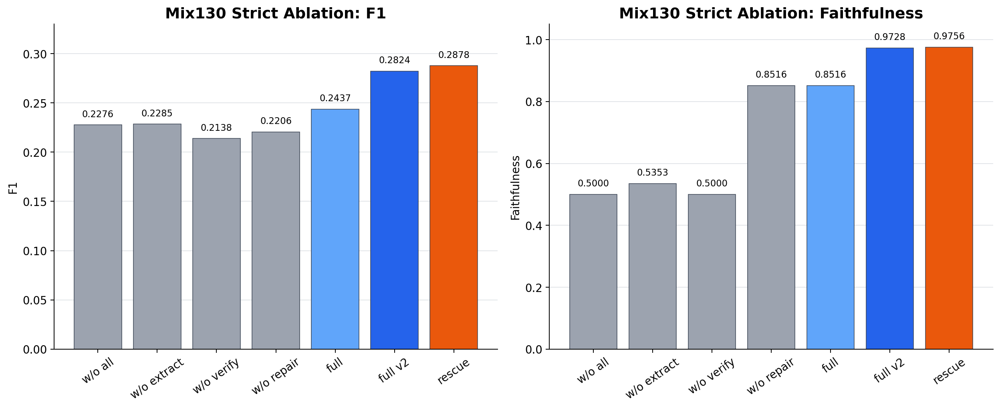

**图 4. Mix130 严格消融结果。** `full_v2` 与 `full_v2_rescue` 在词法质量和忠实度上同时处于较高水平；救援分支的主要收益表现为降低拒答，而非在所有样本上产生同等幅度的 F1 增益。

**总体结果。**

七种配置的结果呈现出质量、忠实度和拒答之间的联合变化。`w/o_all` 和 `w/o_verification` 的忠实度均为 0.5000，说明仅靠基础生成不能稳定建立证据约束；`full_v2` 与 `full_v2_rescue` 的忠实度分别达到 0.9728 和 0.9756，同时 F1 也处于最高水平。该结果支持把 grounding 控制与词法质量一起优化，而不是在二者之间作简单二选一。

运行时间也随控制阶段增加而上升。`w/o_all` 每题 9.0 秒，是最便宜但质量和忠实度较低的配置；完整配置约 41—44 秒。因而表 1 不应只按 F1 排名，实际部署还需要根据风险等级决定是否启用完整链路。

**组件移除结果。**

移除证据抽取后，系统的修复率达到 66.2%，但拒答率升至 40.0%，F1 仅为 0.2285。这说明“尝试修复”的次数多并不代表修复有效，缺少结构化证据时，修复动作可能变成不受支持的文本改写。移除验证后 F1 最低，为 0.2138，表明没有验证信号时，系统既无法可靠保留正确答案，也无法判断哪些样本需要干预。

移除修复后 F1 为 0.2206，忠实度仍有 0.8516，但拒答率为 23.1%。这说明保守保留可以维持一定 grounding，却会放弃本可通过局部修改恢复的答案。完整配置把修复动作引入控制链后，F1 提升到 0.2437，但较高的运行时间和拒答率也显示早期版本的门控仍不充分。

**救援分支的作用。**

`full_v2_rescue` 相对于 `full_v2` 的 F1 增量只有 +0.0054，且不显著，但拒答率下降 7.7 个百分点。该差异说明救援更像尾部风险处理器：它主要处理当前上下文不足、答案近似拒答或存在严重义务缺口的样本，而不是让所有样本的答案都变长。

救援分支的成功条件是新增上下文必须提供缺失义务所需的证据。如果救援只是重复检索相似片段，额外 Token 可能增加而质量不变；如果新增上下文带入矛盾事实，忠实度还可能下降。因此本文将救援后的再次验证作为必要步骤。

### 5.2 跨数据集验证

**表 2：对齐的 VSR 救援验证。**

<table class="three-line-table">
<thead><tr><th>数据集切片</th><th>N</th><th>无修复 F1</th><th>full_v2 F1</th><th>full_v2_rescue F1</th><th>救援相对无修复增量</th><th>救援忠实度</th><th>救援拒答率</th></tr></thead>
<tbody>
<tr><td>UltraDomain mix</td><td>130</td><td>0.2206</td><td>0.2824</td><td><strong>0.2878</strong></td><td>+0.0671</td><td>0.9756</td><td>0.8%</td></tr>
<tr><td>Biology full context</td><td>50</td><td>0.1557</td><td>0.2121</td><td><strong>0.2287</strong></td><td>+0.0729</td><td>0.9586</td><td>4.0%</td></tr>
<tr><td>Legal full context</td><td>20</td><td>0.1791</td><td>0.2407</td><td><strong>0.3496</strong></td><td>+0.1705</td><td>0.9500</td><td>25.0%</td></tr>
<tr><td>Domain expansion windowed</td><td>50</td><td>0.1629</td><td>0.1986</td><td><strong>0.2337</strong></td><td>+0.0708</td><td>0.9277</td><td>22.0%</td></tr>
</tbody>
</table>

救援分支在四个切片上均优于对应的无修复配置。Legal 的增益最大，但样本量较小；Domain 切片的救援忠实度低于 Mix130 和 Biology。这些结果支持内部救援机制具有跨领域稳健性，同时也说明有必要进一步分析成本和失败模式。

图 5 对比四个切片上的无修复配置与救援配置。Legal 的柱高差异最大，但其样本量最小，不能单独代表跨领域平均效果。

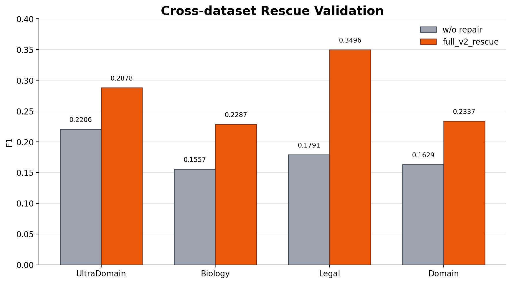

**图 5. 跨数据集救援验证。** 第一组柱表示无修复配置，第二组柱表示 `full_v2_rescue`。

**Biology 切片。**

Biology full context 上，救援配置的 F1 从无修复的 0.1557 提升到 0.2287，增益为 +0.0729，忠实度为 0.9586，拒答率为 4.0%。该切片说明在实体关系较多、说明性答案较常见的场景中，补充证据能够恢复部分缺失陈述，同时不需要大幅提高拒答率。

**Legal 切片。**

Legal full context 上，救援配置达到 0.3496 F1，相比无修复配置提升 +0.1705，是四个切片中最大的绝对增益。但样本量仅为 20，拒答率仍为 25.0%，因此该结果更适合作为“法律切片对证据补足敏感”的信号，而不能单独作为普遍领域结论。

**Domain-expansion 切片。**

Domain-expansion windowed 上，救援配置从 0.1629 提升到 0.2337，增益 +0.0708；但忠实度为 0.9277、拒答率为 22.0%。窗口上下文限制使证据缺口更容易出现，也增加了救援后引入弱支持内容的风险。该切片强调了窗口大小、证据密度和安全阈值之间的共同作用。

### 5.3 冻结 SAGE 候选与锁定留出集

冻结的 SAGE v33-preservation 策略在 326 条来源不重叠样本上评估，包括 unseen75 与 Repeat1-8。由于三种方法都拥有完整的方法输出、同一评分标准下的评审行和成对比较行，该集合是本文的主要外部比较切面。

**表 3：加权锁定留出集元汇总。**

<table class="three-line-table">
<thead><tr><th>方法</th><th>N</th><th>F1</th><th>ROUGE-L</th><th>评审总体分</th><th>成对比较目标胜率</th></tr></thead>
<tbody>
<tr><td>Naive RAG</td><td>326</td><td>0.2972</td><td>0.2338</td><td>2.960</td><td>基线</td></tr>
<tr><td>HyDE</td><td>326</td><td>0.2972</td><td>0.2317</td><td>2.942</td><td>基线</td></tr>
<tr><td><strong>SAGE v33-preservation</strong></td><td><strong>326</strong></td><td><strong>0.3164</strong></td><td><strong>0.2532</strong></td><td><strong>3.555</strong></td><td><strong>相对 HyDE 59.66%；相对 Naive 61.50%</strong></td></tr>
</tbody>
</table>

在主要 unseen75 子集上，SAGE v33 的 F1 为 0.3096、评审总体分为 3.880；HyDE 为 0.2963/3.280，Naive RAG 为 0.2903/3.133。相对于 HyDE 和 Naive，配对评审增益分别为 +0.600（p=1.27e-04）和 +0.747（p=1.87e-06）。Repeat 梯度并非始终为正：Repeat4 与 HyDE 基本持平，Repeat8 的 F1 比 Naive 低 0.0097。本文保留这种混合压力表现，而不只报告最强子集。

**留出集构成。**

锁定聚合包含 unseen75 的 75 条主要样本和 Repeat1-8 的 251 条重复压力样本，共 326 条。所有方法均有完整方法输出，语义评审和成对比较也使用相同评分标准。来源不重叠和冻结前置使该切面适合检验开发结果能否迁移到未参与版本选择的数据。

**词法与语义结果。**

SAGE v33 的 F1 比两个基线高 0.0192，ROUGE-L 比 Naive 高 0.0194、比 HyDE 高 0.0215；评审总体分比 Naive 高 0.595、比 HyDE 高 0.613。词法与语义方向一致，说明该候选的收益不只是参考答案表面重叠增加，也体现在同一评分标准下的答案质量判断中。

成对胜率进一步提供了相对偏好视角：SAGE v33 相对 HyDE 的目标胜率为 59.66%，相对 Naive 为 61.50%。这两个值高于随机水平，但仍不是所有样本都获胜，因此正文同时报告重复压力切片，而不只报告聚合均值。

**压力切片与稳定性。**

Repeat4 与 HyDE 基本持平、Repeat8 落后 Naive 0.0097 F1，说明冻结候选仍存在条件性失败。可能原因包括上下文窗口分布变化、证据密度不足、路由阈值在新来源上的漂移，以及保留防护器过于保守。该现象是后续跨拟合路由实验的动机，也说明锁定留出集不能只用于产生一个单一总分。

图 6 展示锁定留出集的 F1 与语义评审总体分。图中只用于直观比较，精确值以表 3 为准。

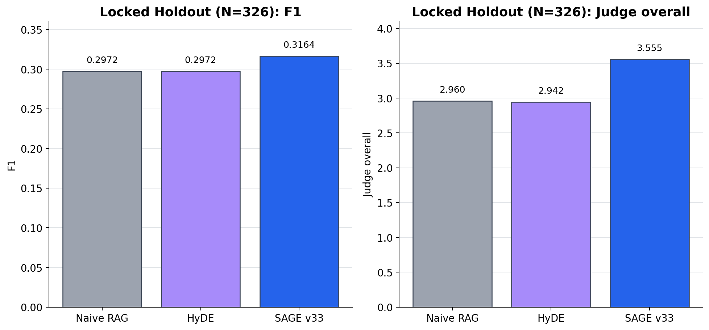

**图 6. 326 条锁定留出样本上的方法比较。** 冻结的 SAGE v33-preservation 同时提高词法指标和语义评审分，但重复压力切片仍存在收益消失或转负的情况。

为进一步区分总体优势与重复压力下的稳定性，图 7 按 Unseen75 和 Repeat1--8 展示 SAGE v33 相对 Naive RAG 与 HyDE 的 F1 差异。该切片不用于重新选择版本，只用于解释表 3 的加权结果由哪些子分布构成。

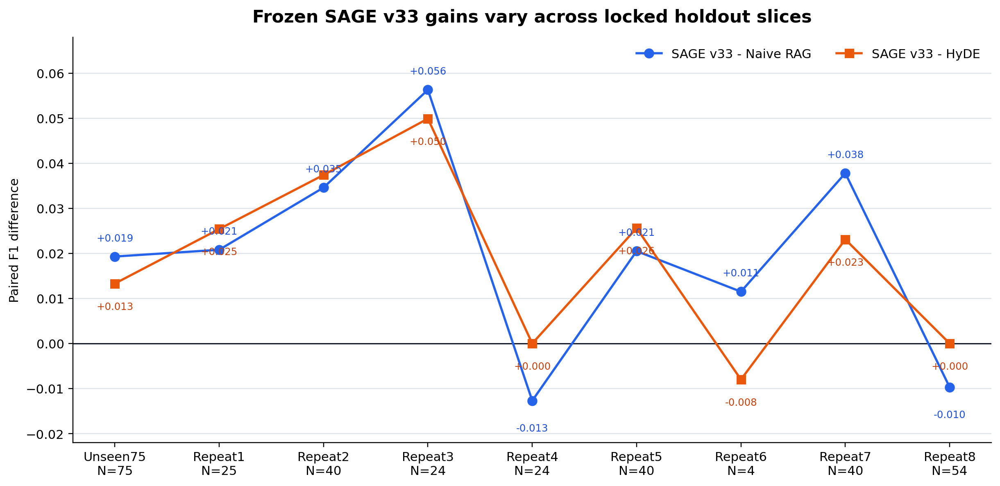

**图 7. 锁定留出集分切片上的 F1 稳定性。** 每个点表示一个锁定子切片中 SAGE v33 相对基线的 F1 差异；Unseen75、Repeat2、Repeat3 和 Repeat7 为正向增益，而 Repeat4 与 Repeat8 显示收益消失或转负。该图强调聚合结果不能替代压力切片分析。

### 5.4 检索与图 RAG 对比

**表 4：对齐切片上的外部检索比较。**

<table class="three-line-table">
<thead><tr><th>数据集</th><th>Naive F1</th><th>HyDE F1</th><th>VSR rescue F1</th><th>SAGE v33 F1</th></tr></thead>
<tbody>
<tr><td>Legal full context（N=20）</td><td>0.3632</td><td>0.3760</td><td>0.3496</td><td><strong>0.3925</strong></td></tr>
<tr><td>Biology full context（N=50）</td><td>0.2365</td><td><strong>0.2385</strong></td><td>0.2287</td><td><strong>0.2385</strong></td></tr>
<tr><td>Domain windowed（N=50）</td><td>0.2711</td><td>0.2549</td><td>0.2337</td><td><strong>0.2881</strong></td></tr>
</tbody>
</table>

当前结果支持分层解释：SAGE v33 在这些切片上达到或超过最佳检索基线，而完整 VSR 救援分支主要由内部机制增益和 grounding 控制来证明其价值。因此，把 `full_v2_rescue` 单独描述为普遍优于 Naive 或 HyDE 的 F1 冠军是不准确的。

补充的图 RAG 比较同样具有参考价值。在 Mix130 补充实验中，GraphRAG-lite 的 F1 为 0.3334，LightRAG current-130 的 F1 为 0.2217，而评估的 SAGE v33 子集 F1 为 0.4646。由于这些运行使用不同执行栈，本文将其作为代表性比较证据，而不是完全受控的官方 GraphRAG 基准。

**表 5：异构图 RAG 补充比较。**

<table class="three-line-table">
<thead><tr><th>数据切片</th><th>GraphRAG-lite F1</th><th>LightRAG F1</th><th>VSR rescue F1</th><th>说明</th></tr></thead>
<tbody>
<tr><td>UltraDomain Mix130</td><td>0.3334</td><td>0.2217</td><td>0.2878</td><td>执行栈不同，作为补充参照</td></tr>
<tr><td>Legal full context</td><td>0.3238</td><td>未运行</td><td>0.3496</td><td>样本量 N=20</td></tr>
<tr><td>Biology full context</td><td>0.2794</td><td>未运行</td><td>0.2287</td><td>样本量 N=50</td></tr>
<tr><td>Domain windowed</td><td>0.2928</td><td>未运行</td><td>0.2337</td><td>窗口上下文协议不同</td></tr>
</tbody>
</table>

表 5 的作用是给出不同图检索执行栈的数量级参照，而不是重新定义本文的主基线。尤其是 LightRAG current-130 只覆盖当前 130 条子集，不能与 326 条锁定留出集的 SAGE 结果直接比较；GraphRAG-lite 的不同切片也没有共享完全相同的提示和上下文预算。将这些差异显式写入表注，比只报告一个有利的图 RAG 数字更符合可复核的比较原则。

该结果显示，VSR rescue 的主要证据不是“在每个外部切片上取得最高 F1”，而是通过内部对齐实验证明验证、修复和救援机制的作用，并通过冻结候选证明证据感知路由具有一定泛化能力。GraphRAG-lite 和 LightRAG 的结果可用于说明不同图检索执行栈的性能范围，但由于基础设施和提示协议不完全一致，不应据此计算严格的统计显著性。

### 5.5 运行时间与 Token 成本

验证与救援会带来明显成本。在对齐外部切片上，`full_v2_rescue` 每题耗时 43.3—59.6 秒，Naive RAG 为 5.6—6.8 秒，HyDE 为 14.4—20.7 秒；因此 VSR/Naive 的运行时间比为 6.88—9.89 倍。有调用记录的 N=20 样本平均每个救援问题约调用 5.5 次 LLM、消耗 12,558 个 Token，其中救援证据抽取是主要 Token 消耗阶段。

成本证据改变了设计表述：该贡献不是免费的质量提升，而是一个可控制的质量、grounding 与拒答层，其升级预算必须选择性分配。当前机制审计也支持这一点：风险概率与观测到的 SAGE 相对 VSR F1 增量负相关（-0.3782），路由选中的样本平均增益低于跳过路由的样本（+0.1119 对比 +0.2089）。原型影响感知选择器将回顾性匹配预算增益代理从 +0.0299 提升到 +0.0489，但这只是产生假设的证据，还不能视为因果结论。

图 8 将三个外部切片的运行时间和 F1 分别取算术平均后放在同一坐标系中。VSR rescue 的平均运行时间明显高于 Naive RAG 和 HyDE，且在这三个延迟可配对的方法中 F1 均值最低；SAGE v33 只以锁定留出集 F1 注释呈现，因为其运行时间未按同一三切片协议配对。该图用于描述当前对齐切片的总体位置，不应被解释为跨数据集的因果效应或完整 Pareto 前沿。

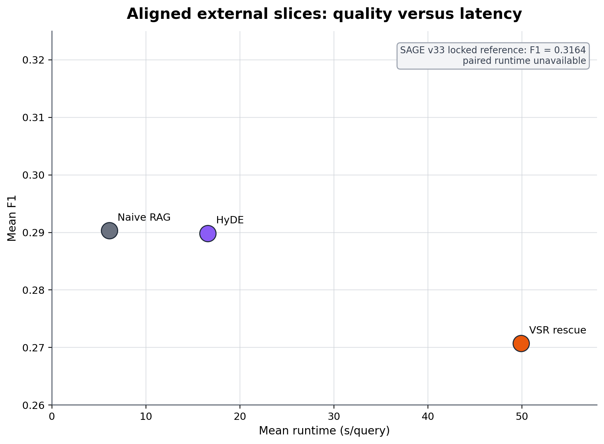

**图 8. 外部对齐切片上的质量—成本位置。** 三个散点是 Legal、Biology 和 Domain-expansion 的算术平均；横轴为运行时间（秒/题），纵轴为 F1。右上角注释给出 SAGE v33 在 326 条锁定留出样本上的 F1，但由于缺少同协议运行时间，不将其绘制为可直接比较的散点。

**延迟比较。**

在 Legal、Biology 和 Domain 三个外部切片上，Naive RAG 的每题时间为 5.6—6.8 秒，HyDE 为 14.4—20.7 秒，VSR rescue 为 43.3—59.6 秒。VSR 的额外延迟来自多次模型调用和证据处理，而不是单一生成步骤。对于批处理离线评价，这种成本可以接受；对于交互式应用，则需要门控和缓存来限制触发率。

**Token 与调用开销。**

仪表化 N=20 样本平均每个救援问题约调用 5.5 次 LLM、消耗 12,558 个 Token。救援证据抽取是主要 Token 阶段，其次是生成和修复后验证。该分解说明优化方向不只是压缩最终答案，还包括减少重复证据抽取、缓存已经验证的路径，以及让低风险问题提前结束。

图 9 进一步拆分仪表化样本中各 LLM 阶段的 Token 消耗。图中统计单位是“每次执行阶段”的 Token，而不是每道题的总 Token；救援证据抽取阶段的均值较高，说明升级路径的成本主要由重新构造证据上下文驱动。

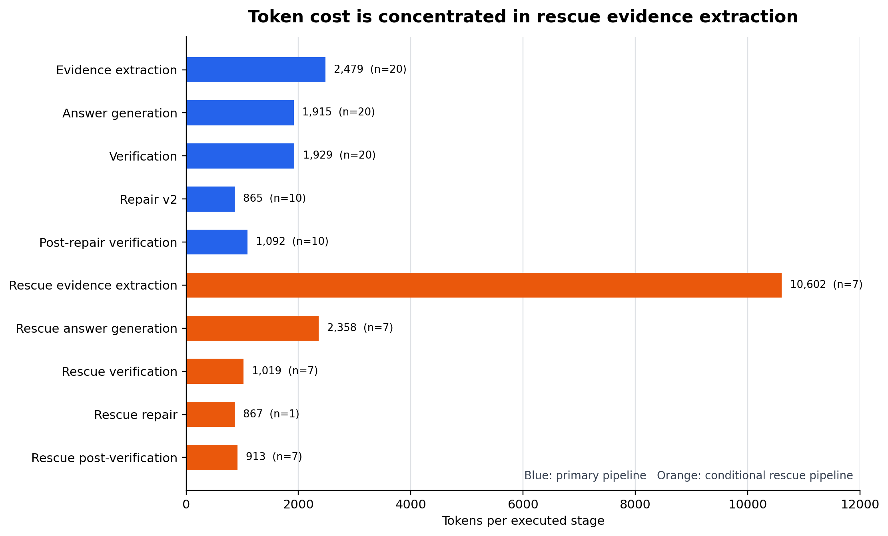

**图 9. 仪表化样本的 Token 阶段分解。** 柱高表示对应阶段一次执行的平均 Token 数，括号内为观测次数。普通路径与救援路径分开统计，不能将不同阶段直接相加后解释为每题总成本；完整总成本仍以正文中的 12,558 Token/题均值为准。

**选择性升级的必要性。**

风险概率与观测质量增量的负相关表明，当前门控并未直接优化升级收益。一个可部署的控制器应估计三种结果：不升级时的预期质量、升级后的预期质量，以及升级的额外成本和错误风险。只有当预期净收益为正时才触发 rescue；否则应保留、局部修复或拒答。当前原型的 +0.0489 回顾性增益代理只能作为未来策略的初始信号。

图 10 将 Mix130 七种配置放在同一个三维坐标系中：横轴为 F1，纵轴为每题运行时间，竖轴为忠实度。该图用于显示三个目标之间的联合关系，而不是构造新的综合评分。`full_v2` 与 `full_v2_rescue` 位于高忠实度区域，`full_v2_rescue` 的 F1 略高但运行时间略增；`w/o_all` 虽然成本最低，却同时处于较低 F1 和较低忠实度区域。

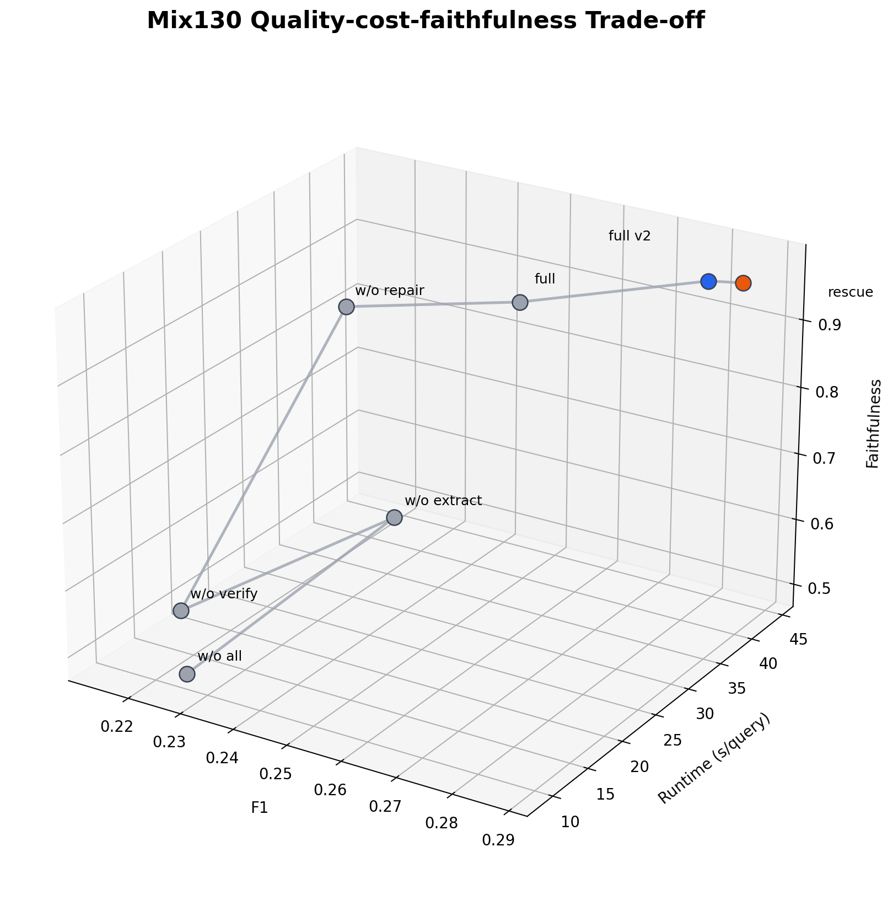

**图 10. Mix130 质量—成本—忠实度三维关系。** 每个点代表一种严格消融配置，连线仅用于显示配置演化轨迹，不表示连续优化路径。精确数值以表 1 为准；可编辑 SVG 版本位于 `paper/figures/mix130_quality_cost_faithfulness_3d.svg`。

### 5.6 失败模式与质量分析

已完成的质量审计识别出四类重复出现的失败模式：

1. **证据缺口：** 检索材料没有覆盖问题要求的全部方面；
2. **过度保守的拒答或救援门控：** 在可修复样本上没有及时干预；
3. **修复中出现幻觉或弱支持的新增内容；**
4. **Token 成本增加，以及救援密集样本中偶发的忠实度下降。**

**表 6：15 条质量审计样本的问题标签计数。**

<table class="three-line-table">
<thead><tr><th>问题标签</th><th>计数</th><th>审计含义</th></tr></thead>
<tbody>
<tr><td>证据缺口</td><td>5</td><td>当前上下文未覆盖问题所需事实</td></tr>
<tr><td>救援门控过度</td><td>4</td><td>救援加入了不必要或弱支持内容</td></tr>
<tr><td>答案幻觉</td><td>4</td><td>输出包含证据无法推出的具体陈述</td></tr>
<tr><td>过度保守拒答</td><td>1</td><td>存在可用高层证据但仍拒答</td></tr>
<tr><td>合理拒答</td><td>1</td><td>证据不足时拒答是适当行为</td></tr>
</tbody>
</table>

这些标签是多标签审计结果，同一案例可以同时属于多个类别，因此总计不应解释为 15 条样本的互斥分组。该限制也说明为什么本文将错误分析作为机制诊断，而不是把小样本标签比例外推为总体错误率。

更长上下文诊断进一步表明，仅增加上下文并不是安全修复：80k 上下文诊断相对于当前救援线的平均 F1 增量为 -0.0360，只有 2 胜 5 负。这支持本文强调证据选择和契约检查，而不是单纯增加上下文长度。

成本仪表化样本提供了更具体的失败证据。Biology 的 5 条样本中，rescue 相对于无修复平均提高 0.1622 F1，且没有观察到忠实度下降；Domain-expansion 的 5 条样本平均下降 0.0272 F1，并出现两条未被记录的有效拒答；Legal 的 10 条样本平均提高 0.0669 F1，但平均忠实度相对于 `full_v2` 下降 0.133。由此可见，救援收益具有明显的领域条件性，不能用一个全局平均值掩盖安全性退化。

案例审计还发现两种值得单独处理的错误。第一，Domain-expansion 中的一条修复把原本的英文拒答改成中文拒答，导致词法 F1 下降到 0，但其语义行为仍然是“证据不足时拒答”；这说明语言控制和词法指标之间可能出现不一致。第二，Legal 中有两条救援样本出现忠实度下降，其中一条下降到 0，表明更长上下文并不自动保证更安全的输出。后续实验需要单独记录有效拒答、语言一致性和修复后忠实度，而不能只看 F1。

这些案例也解释了为什么本文不把 rescue 率或修复率当作单独的成功指标。一个安全的系统应优先区分“正确拒答”“无效救援”“错误修复”和“证据充分但表达不一致”四类状态，并在统计时分别计数。图 11 汇总了 15 条已审计样本中的问题标签：证据缺口和救援门控过度是最常见的两类问题，说明后续工作应优先改进证据覆盖和救援接受门，而不是继续无条件扩大上下文。

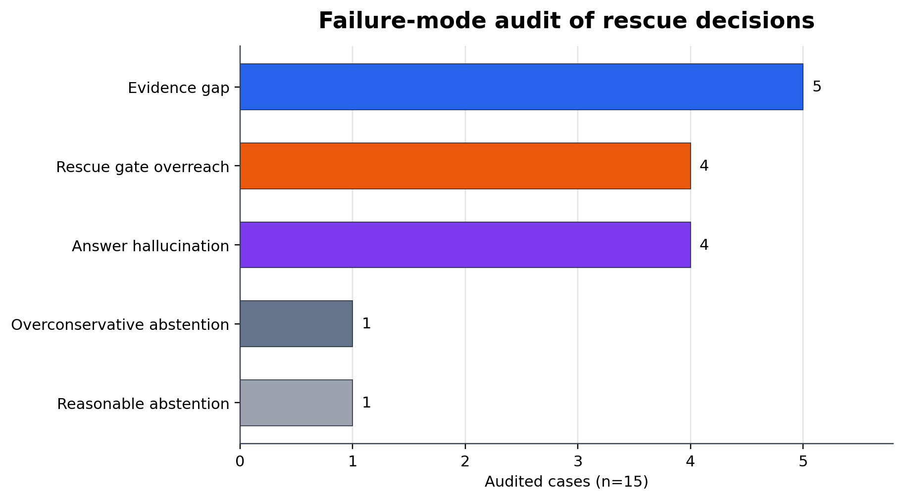

**图 11. 救援决策失败模式审计。** 统计来自 15 条跨数据集质量审计样本；同一案例可能带有多个标签，因此各柱计数不应相加解释为互斥类别。该图用于定位控制器的改进优先级，不用于估计总体错误率。

### 5.7 研究问题回答

- **RQ1（机制）：** 是。严格消融显示，验证、修复和救援组合相对于无修复配置带来 +0.0671 F1，并保持 0.9756 忠实度；但救援相对于 `full_v2` 的平均 F1 增量较小，其主要作用是降低困难样本的拒答。
- **RQ2（泛化）：** 在当前四个对齐切片上，救援分支均优于无修复配置；不过 Legal 样本量较小，Domain 的忠实度较低，结论应限定在这些切片范围内。
- **RQ3（比较）：** 是，但仅针对冻结的 SAGE v33-preservation 候选。它在 326 条锁定留出样本上优于 Naive RAG 和 HyDE；这不等价于所有 VSR 分支都普遍优于所有检索基线。
- **RQ4（成本与失败）：** 验证和救援带来约 6.88—9.89 倍的运行时间比，并引入额外 Token、拒答和错误升级风险。当前风险分数更适合识别困难样本，尚不足以单独决定是否值得升级。

## 6 讨论

### 6.1 机制结果的解释

严格消融的结果支持一个分阶段的解释。首先，单独加入验证并不会自动带来最高 F1；如果验证结果没有进入修复和提交控制，系统可能只是更频繁地发现问题，却没有能力恢复可提交答案。其次，`full_v2` 相对于原始 `full` 同时提高 F1 和忠实度，说明答案实现方式、保留防护和门控策略与验证模块本身同样重要。最后，`full_v2_rescue` 只比 `full_v2` 增加 0.0054 F1，却把拒答率从 8.5% 降至 0.8%，这表明救援的主要价值集中在拒答触发的困难样本，而不是平均提升所有样本。

因此，VSR 的贡献不应简单表述为“增加一个验证器后分数上升”，而应描述为一条控制链：识别问题、判断缺口、限制修复、必要时扩展证据，最后再进行提交或拒答。该链条也解释了为什么删除任一关键阶段都会出现不同类型的退化：删除验证会降低支持判断质量，删除修复会降低可恢复性，删除救援会保留较高的困难样本拒答率。

### 6.2 跨数据集泛化

救援分支在 UltraDomain、Biology、Legal 和 Domain-expansion 四个切片上均超过对应的无修复配置，说明该机制并不完全依赖某一领域的词汇分布。Legal 的 +0.1705 F1 增益最为突出，可能反映法律问题中义务拆分和证据缺口更容易通过额外上下文修复；但 Legal 只有 20 条样本，且救援拒答率仍为 25.0%，所以不能把该结果外推为所有法律任务的稳定规律。

Biology 的忠实度为 0.9586，Domain-expansion 的忠实度为 0.9277，均低于 Mix130 的 0.9756。这说明跨领域泛化不仅要看 F1 增益，也要同时检查修复后陈述是否仍被证据支持。换言之，救援机制在不同领域上具有方向一致的收益，但其安全边界和拒答策略仍需领域级校准。

### 6.3 与外部基线的关系

326 条锁定留出样本给出了最完整的外部比较证据：冻结的 SAGE v33-preservation 在 F1、ROUGE-L、语义评审和成对比较上都优于 Naive RAG 与 HyDE 的加权结果。该结果的可信度主要来自三个条件：候选在评估前冻结；留出样本与开发切面零重叠；三种方法拥有完整且可对齐的评价行。

另一方面，外部切片上的 VSR rescue F1 并非始终最高。例如 Legal 上 SAGE v33 为 0.3925，高于 VSR rescue 的 0.3496；Biology 上 HyDE 与 SAGE v33 均为 0.2385，高于 VSR rescue 的 0.2287。因此，本文将 SAGE v33 的结果解释为冻结路由候选的比较证据，将 `full_v2_rescue` 的结果解释为 VSR 内部机制证据，避免把两个不同实验问题混成一个“统一最高分”结论。

### 6.4 质量与成本权衡

VSR rescue 的平均运行时间为 43.3—59.6 秒/题，而 Naive RAG 仅为 5.6—6.8 秒/题。额外成本来自多阶段证据抽取、陈述验证、反事实检查、修复和二次生成。对于对延迟敏感的在线系统，不能对所有问题无条件执行完整流程；对于高风险领域，则可以把 VSR 作为只对高风险或高缺口样本启用的二级控制层。

风险分数目前更像“困难度”指标，而不是“干预收益”指标。风险概率与观测的 SAGE 相对 VSR F1 增量为负相关，路由选中样本的平均增益也低于路由跳过样本。这一现象说明“问题很难”和“额外干预有效”是两个不同事件。未来的路由器应直接估计升级后的预期收益减去额外成本，而不仅仅是估计当前答案的风险。

### 6.5 主要结论的边界

本文支持以下较窄的结论：证据契约、验证、受控修复和选择性救援可以构成一个有用的 RAG 控制层；在当前实验切片和锁定协议下，该控制层带来内部机制收益，并且冻结路由候选具有一定跨切面竞争力。

本文不支持以下更强的结论：所有 VSR 配置都优于所有检索基线；风险分数已经是可直接使用的校准概率；扩大上下文长度本身能够解决 grounding 问题；补充的 GraphRAG-lite 和 LightRAG 运行等价于完全受控的官方基线；LLM 语义评审可以替代人工事实性评估。

本文将实验结论按证据强度分为三层。第一层是内部机制证据，包括 Mix130 严格消融和跨数据集 rescue 对齐结果；第二层是外部比较证据，包括 SAGE v33-preservation 在 326 条锁定留出样本上的结果；第三层是探索性或异构补充证据，包括部分图 RAG 比较、成本诊断和影响感知选择器。只有前两层用于支撑正文主结论，第三层用于解释系统行为和规划后续实验，不用于宣称统一基线优势。

图 12 汇总本文的证据链：从内部机制隔离开始，经过跨数据集验证、外部比较和方法冻结，最后以锁定留出集及成本/失败审计限定结论范围。该证据边界避免把不同数据、执行栈或冻结状态下的结果直接合并。

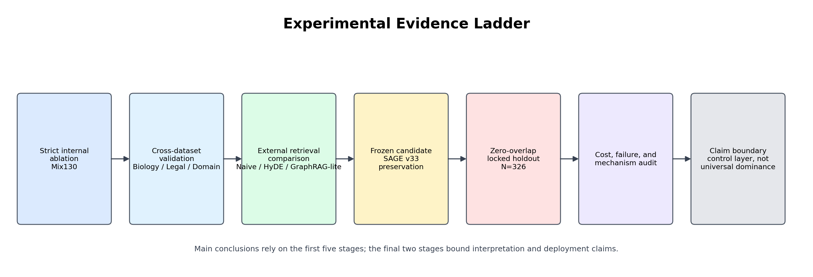

**图 12. 实验证据链。** 论文主结论只建立在内部对齐实验和冻结锁定评估之上，异构图基线和影响感知路由用于补充解释与提出后续问题。

## 7 局限性与未来工作

### 7.1 数据与实验范围

当前数据由本地基准切片、锁定留出集和历史补充运行组成，尚未覆盖足够多的公开数据集、语言和任务类型。尤其是 Legal 切片样本量较小，不能支撑细粒度领域结论；GraphRAG-lite 与 LightRAG 的样本规模和执行栈也不完全相同。后续工作需要在公开、来源独立且规模更大的数据上重新冻结候选，并明确训练、调参和评估的边界。

此外，当前实验主要围绕图文本混合证据和英文/中文混合输出展开，尚未系统比较不同语言、不同知识库质量和不同模型规模下的行为。图谱中的实体链接错误、关系缺失和文本证据冲突可能会改变 MPS 与 CPN 的输入分布；如果不单独控制这些因素，无法判断性能下降来自控制器还是来自底层知识库。因此后续数据扩展应同时记录知识库版本、实体链接准确率、证据密度和上下文窗口，而不只增加问题数量。

### 7.2 评价与因果性限制

第一，精确 Token/调用成本只在代表性样本上完成了仪表化，历史记录不一定具有同等完整度。第二，SAGE 相对 VSR 的观测差异不是随机分配的升级处理效应，因此不能直接解释为救援的因果收益。第三，语义评审和成对比较依赖同一评分协议，可能存在评审偏差。第四，词法 F1 的提高不能单独证明事实性提高，忠实度指标也不能替代人工逐条核验。

还需要区分“统计显著”与“实际重要”。Legal 切片的增益具有统计信号，但样本量只有 20；锁定聚合的加权优势来自多个压力切片的合并，其中 Repeat4 和 Repeat8 已经显示收益可能消失或转负。因而本文不把聚合结果解释为所有子分布上的一致改进，而把它作为冻结候选在当前留出协议下的总体证据。

最后，当前风险分数的权重和阈值仍具有工程设定成分。它可以作为运行时门控，但还没有经过大规模人工事实性标注或概率校准。投稿前需要在独立开发集上进行校准曲线、可靠性分析和阈值敏感性实验，报告不同拒答率下的质量—覆盖曲线，而不是只给出一个默认阈值。

### 7.3 后续实验计划

下一阶段不再进行无约束的版本扫描，而采用“冻结—跨拟合—新来源评估”的流程：

1. 在开发数据上冻结风险特征、升级策略和预算；
2. 使用跨拟合或交叉验证估计升级收益，避免在同一切片上选择门控阈值；
3. 在新的来源数据上同时运行 preserve、repair、rescue 和 abstain 四种状态；
4. 同时报告基础质量、升级后的质量、额外 Token、延迟、实际升级收益和错误升级率；
5. 用人工标注检查语义评审与忠实度分数的相关性。

该设计可以把“识别困难样本”和“识别值得干预的样本”分开评价，并为成本感知路由提供真正的因果证据。

在方法层面，未来还可以沿三个方向扩展。其一，将 MPS 从当前启发式选择扩展为带证据置信度、路径长度和 Token 价格的多目标优化；其二，把 CPN 的留一干预扩展为成组路径干预，识别多个证据共同构成的最小证明；其三，将修复候选的编辑距离、证据支持度和语言一致性纳入统一的安全约束。每个扩展都应先在开发集完成设计，再在新来源锁定集上单独验证，避免把多个变化同时引入而无法解释。

在应用层面，VSR 适合高风险问答、法律条款检索和需要审计记录的知识服务，但不一定适合所有低延迟聊天场景。实际部署可以采用分层策略：先运行低成本检索和轻量契约检查，只有在风险、缺口和潜在收益同时超过阈值时才调用完整救援；对于批量离线任务，则可以利用缓存复用已经验证的证据路径。该策略能够把本文的机制贡献转化为可测量的资源分配问题。

## 8 结论

### 8.1 主要发现

本文提出 VSR-PathRAG，一种面向图 RAG 的证据契约验证、评分、修复和救援层。实验得到四点主要发现：

1. 在 Mix130 严格消融中，`full_v2_rescue` 相比无修复配置提升 0.0671 F1，并达到 0.9756 忠实度；
2. 救援分支在 Biology、Legal 和 Domain-expansion 切片上均产生正向增益，但不同领域的拒答率和忠实度仍存在差异；
3. 冻结的 SAGE v33-preservation 在 326 条零重叠留出样本上优于 Naive RAG 与 HyDE 的加权词法和语义结果；
4. 验证、修复和救援带来显著的 Token 与延迟成本，风险分数还不能直接作为升级收益预测器。

综合来看，内部消融回答了“这些机制是否能够改善对齐样本上的答案控制”，锁定留出实验回答了“冻结后的候选是否能迁移到未参与选择的数据”，成本和案例审计则回答了“这种改善需要付出什么代价、在哪些情况下会失效”。三类证据共同构成本文的主要贡献，而不是由某一个最高 F1 数字单独支撑结论。

### 8.2 研究结论与适用范围

综合上述结果，VSR-PathRAG 应被理解为 RAG 系统中的证据验证与输出控制层，而不是替代检索器或生成器的独立模型。它通过证据契约连接问题义务、答案陈述和图文本证据，并根据验证结果在保留、修复、救援和拒答之间进行选择。当前实验表明，该控制层能够改善对齐切片上的答案质量和忠实度，但同时会增加运行时间与 Token 消耗。

在应用范围上，VSR-PathRAG 更适合高风险问答、法律条款检索、科研知识服务以及需要保留证据路径和干预记录的场景。对于低延迟、低风险的开放式聊天任务，完整验证和救援链路的成本可能不具备实际优势，宜采用轻量契约检查或仅对高风险样本选择性升级。

本文不声称所有 VSR 配置都优于所有检索基线，也不声称风险分数已经经过充分校准，能够直接预测干预收益。本文的主要贡献是提供一种可审计的证据控制机制，并通过严格消融、跨数据集验证、冻结候选比较和成本审计明确其有效条件与失效边界。后续研究应在更大规模、来源独立的数据上检验影响感知路由、人工事实性评价和成本收益校准。

## 参考文献

以下条目构成当前中文主稿的正式参考文献初版；投稿前仍需按目标期刊格式统一 DOI、卷期和页码信息。

1. Gao, L. et al. *ALCE: Enabling Large Language Models to Generate Text with Citations*. EMNLP, 2023. [ACL Anthology](https://aclanthology.org/2023.emnlp-main.398/)
2. Asai, A. et al. *Self-RAG: Learning to Retrieve, Generate, and Critique through Self-Reflection*. ICLR, 2024. [OpenReview](https://openreview.net/forum?id=hSyW5go0v8)
3. Saad-Falcon, J. et al. *ARES: An Automated Evaluation Framework for Retrieval-Augmented Generation Systems*. NAACL, 2024. [ACL Anthology](https://aclanthology.org/2024.naacl-long.20/)
4. Niu, C. et al. *RAGTruth: A Hallucination Corpus for Developing Trustworthy Retrieval-Augmented Language Models*. ACL, 2024. [ACL Anthology](https://aclanthology.org/2024.acl-long.585/)
5. Chen, X. et al. *Synchronous Faithfulness Monitoring for Trustworthy Retrieval-Augmented Generation*. EMNLP, 2024. [ACL Anthology](https://aclanthology.org/2024.emnlp-main.527/)
6. Ru, D. et al. *RAGChecker: A Fine-grained Framework for Diagnosing Retrieval-Augmented Generation*. NeurIPS, 2024. [DOI](https://doi.org/10.52202/079017-0692)
7. He, X. et al. *G-Retriever: Retrieval-Augmented Generation for Textual Graph Understanding and Question Answering*. NeurIPS, 2024. [DOI](https://doi.org/10.52202/079017-4224)
8. Gutierrez, B. J. et al. *HippoRAG: Neurobiologically Inspired Long-Term Memory for Large Language Models*. NeurIPS, 2024. [DOI](https://doi.org/10.52202/079017-1902)
9. Es, S. et al. *RAGAs: Automated Evaluation of Retrieval Augmented Generation*. EACL Demo, 2024. [ACL Anthology](https://aclanthology.org/2024.eacl-demo.16/)
10. Guo, Z. et al. *LightRAG: Simple and Fast Retrieval-Augmented Generation*. Findings of EMNLP, 2025. [ACL Anthology](https://aclanthology.org/2025.findings-emnlp.568/)
11. Edge, D. et al. *From Local to Global: A Graph RAG Approach to Query-Focused Summarization*. Technical report, 2024. [arXiv](https://arxiv.org/abs/2404.16130)
12. Yan, S.-Q. et al. *Corrective Retrieval Augmented Generation*. Preprint, 2024. [arXiv](https://arxiv.org/abs/2401.15884)

---

**图稿来源：** 本稿正文直接引用 `paper/figures/` 中的 PNG 图像以保证常见 Markdown 预览器可见；对应的 SVG、Mermaid 源和精确绘图数据位于 [`PAPER_FIGURES.md`](PAPER_FIGURES.md)。
